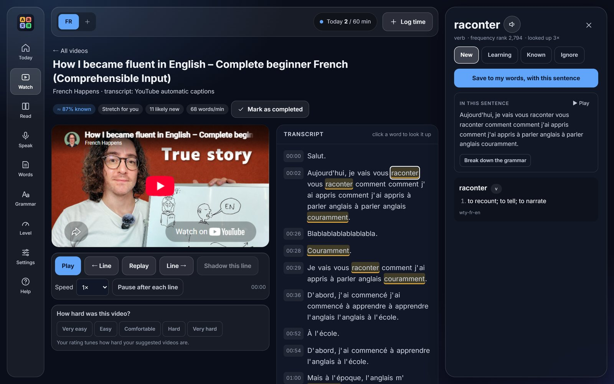
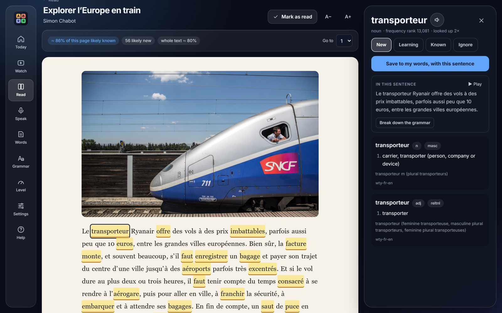
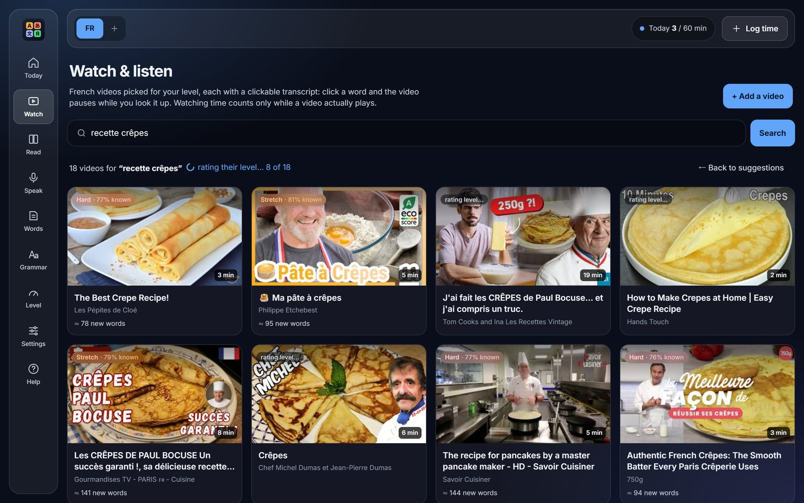
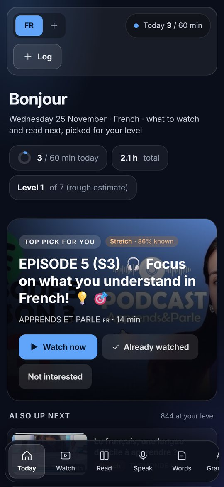
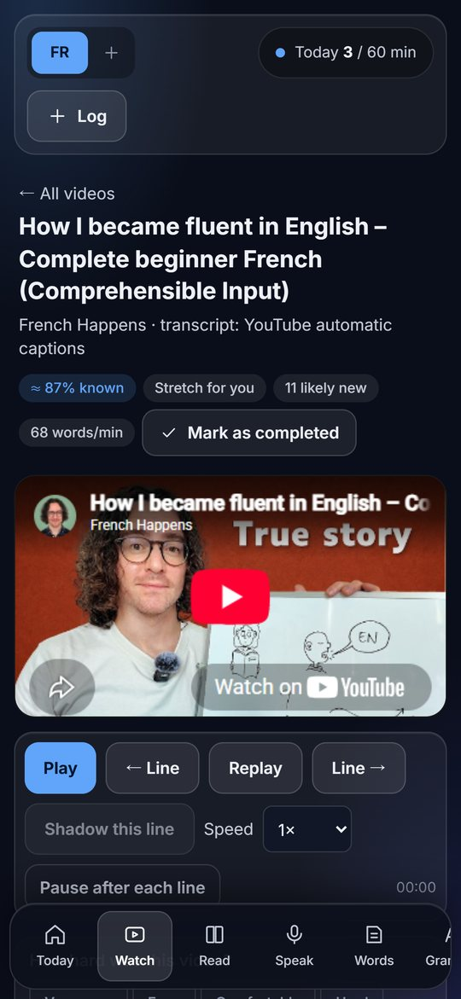

<p align="center"></p>

# Lingo OS

**Learn a language by watching, reading and listening to things you enjoy, at the right level for you.**

Lingo OS is a free, local-first app for learning languages through comprehensible input: **Mandarin Chinese, Hindi,
Spanish, Arabic, French, Bengali, Portuguese, Russian, German, Japanese, Korean and Italian** (Arabic right to left). It
finds YouTube videos and articles matched to your level, gives every video a clickable transcript and every text
clickable words, tracks your immersion time, and estimates your level from what you actually understand. It runs on
your computer, keeps your data there, and comes with an Android app that syncs over your home Wi-Fi.

No flashcards and no streak pressure: the words you save come back through the videos and articles you're shown.

<p align="center">
  
</p>

<p align="center">
  <a href="#install-it-on-your-computer"><b>Install</b></a> ·
  <a href="#the-android-app"><b>Android app</b></a> ·
  <a href="#optional-extras"><b>Extras</b></a> ·
  <a href="#your-data-and-privacy"><b>Privacy</b></a> ·
  <a href="#for-developers"><b>Developers</b></a>
</p>

## What you can do

### Today: what to watch and read next

A daily top pick and rows of videos and articles chosen for your level, with your goal for the day and your progress.
Every card says how much of it you should understand (**% known**) and whether it's comfortable, a stretch or hard.
Picks get easier or harder as you rate them, favour the channels and topics you finish, never repeat what you've
watched (mark anything as already watched or read), and new ones are found in the background.

### Watch: every word in the transcript is clickable



YouTube (or your own video and audio files) next to a synced transcript. Click any word: the video pauses and the
dictionary opens. Replay a line, slow it down, pause after each line, or send it to shadowing practice. Rate how hard
the video was and your suggestions adjust.

### Read: articles, books and PDFs with their pictures



Articles from news and learner sites (pictures included), your own books (EPUB), PDFs and pasted texts. Every word is
clickable and colour-coded by how likely you are to know it, and the page tells you how much of it you should follow.

### Search YouTube and the news, rated for you



Search in the language you're learning: results appear at once, like on YouTube, and each one's level fills in a few
seconds later, so you see how hard a video or article is before you open it.

### And also

- **Look up any word**: its dictionary form (*rufe … an* → *anrufen*, 間に合わない → 間に合う), meanings, readings and a
  native voice reading it aloud. Save it with the sentence you met it in.
- **Words move up on their own**: a word you keep meeting without looking it up goes from learning to familiar to known,
  and you can move it back.
- **Level Lab**: short tests (vocabulary, reading, listening, speaking) that give your level as a range.
- **Speak**: an AI tutor that talks at your level (optional: Gemini, Claude or ChatGPT), and shadowing practice.
- **Grammar**, **Manga** (Japanese, with clickable speech bubbles), **weekly reports**, and an **Android app**.

## Install it on your computer

Lingo OS is developed and tested on **Windows**. macOS and Linux should work but are less tested.

### 1. Install the tools (once)

You need [Git](https://git-scm.com/), [Node.js](https://nodejs.org/) 18 or newer, and
[uv](https://docs.astral.sh/uv/) (it installs the right Python for you). On Windows, in PowerShell:

```powershell
winget install Git.Git OpenJS.NodeJS.LTS astral-sh.uv
```

On macOS: `brew install git node uv`. On Linux: Git and Node.js from your package manager, then
`curl -LsSf https://astral.sh/uv/install.sh | sh`. Close and reopen the terminal afterwards.

Optional: [ffmpeg](https://ffmpeg.org/) (`winget install Gyan.FFmpeg`), only needed for your own video and audio files.

### 2. Download Lingo OS and set it up

```powershell
git clone https://github.com/proy9714/lingo-os.git
cd lingo-os
npm run setup
```

`setup` installs everything and creates your (empty) database in the `data` folder. It takes a few minutes the first
time.

### 3. Start it

```powershell
npm run start
```

Open **http://127.0.0.1:8787** in your browser. Keep the terminal open while you use the app; press Ctrl+C there to
stop it. Next time, `npm run start` is all you need.

### 4. First steps in the app

1. Choose the language you want to learn (and its variety, e.g. Brazilian or European Portuguese). Lingo OS downloads
   what it needs for it, a language model and a dictionary (about 10 to 70 MB), in the background. Add more languages
   any time in **Settings → Languages**, or with the **+** next to the language buttons at the top.
2. Tell it where you're starting from: a level you choose, the hours you've already spent on the language, your
   Immersion Tracker history, or nothing at all. For a measured start, take the 5-minute vocabulary test in **Level**.
   Set your daily goal in **Settings**.
3. Go to **Today** or **Watch**. Suggestions are found in the background in your first minutes; they appear as they're
   found.
4. Time you spend away from the app (a podcast, a class) can be added with **Log time** (or Ctrl+L).

Stuck? Run `npm run doctor`: it checks your setup and says what to fix. The **Help** page in the app explains every screen.

## The Android app

<p align="center">
  
  &nbsp;&nbsp;
  
</p>

Install [Obtainium](https://github.com/ImranR98/Obtainium) on your phone, tap **Add app**, paste
`https://github.com/proy9714/lingo-os`, then **Install**. Obtainium tells you when there's an update. (Or download the
`.apk` from the [latest release](https://github.com/proy9714/lingo-os/releases/latest).)

The phone works through your computer: turn on Settings → **Phone** on the computer, then scan the pairing code with
the app. Both must be on the same Wi-Fi. Away from home, texts you saved for offline still work, and everything you
do syncs when you're back. Details in [docs/PHONE.md](docs/PHONE.md).

## Optional extras

- **AI explanations and the tutor**: use **Gemini**, **Claude** or **ChatGPT**. Create an API key
  ([Gemini](https://aistudio.google.com/apikey), free tier · [Claude](https://platform.claude.com/settings/keys) ·
  [ChatGPT](https://platform.openai.com/api-keys)), then in **Settings → AI explanations** pick the provider, paste
  the key (it's saved in `.env` on your computer) and press **Test connection**. You can also choose which models
  it uses. Other providers (a local Ollama, OpenRouter, any OpenAI-compatible server) are set in `config/llm.yaml`.
  Everything else works without AI.
- **Voices**: words and sentences are read by native neural voices, whatever voices your computer has. Choose a voice
  per language in Settings → **Voices**, or switch to your device's own voices to stay fully offline.
- **Your own videos and audio**: put them in `data\library\media\<language>\` with a same-named `.srt` or `.vtt`
  subtitle file, then **Watch → Add a video → Scan**.
- **Manga** (Japanese): drop volumes processed with mokuro into `data\inbox\manga\`.
- **Immersion Tracker users**: put its data folder in `config/app.local.yaml` (`immersion_tracker: { path: ... }`) and
  press **Sync now** in Settings to bring in your history.
- **AI terminals**: open Claude Code, Gemini CLI or Codex in this folder and type `/lingo` for status, recommendations,
  weekly reviews and more.
- **Scheduled runs** (Windows): `powershell -ExecutionPolicy Bypass -File scripts\schedule-windows.ps1` runs a daily
  content search and the Sunday review.

## Updating

```powershell
git pull
npm run setup
npm run start
```

Your data in `data\` is kept, and the database is upgraded automatically. The phone updates through Obtainium.

## Your data and privacy

Everything you do (words, history, levels, notes, recordings) stays in the `data` folder on your computer. Back that
folder up to keep it safe. The app goes online only to play and search YouTube, read the article sites in
`config/sources.yaml`, read a sentence aloud the first time (Microsoft's speech service; can be turned off), ask the AI
provider you set up when you ask for an explanation, and talk to your own phone over your Wi-Fi, encrypted.

## For developers

| Command | What it does |
|---|---|
| `npm run dev` | API on http://127.0.0.1:8787 and the app on **http://localhost:5173**, both reloading on changes |
| `npm test` | Backend tests plus the frontend typecheck |
| `npm run status` | Hours, today vs goal and starting level per language (`-- --json`) |
| `npm run doctor` | Check Python, data folder, databases, build, ffmpeg and API keys |
| `npm run import-tracker` | Import or re-sync Immersion Tracker CSVs |
| `npm run update-content` | Find new videos and articles near your level (`-- --lang es --dry-run`) |
| `npm run evolve-profile` | Weekly review and report (`-- --no-llm`, `-- --dry-run --json`) |
| `npm run lingo -- dict list` | Show installed dictionaries |
| `npm run lingo -- content fetch-history` | Fetch and analyse captions of the videos you've watched |
| `npm run lingo -- content rescore` | Refresh the starting estimate and re-score the library |
| `npm run lingo -- recommend` | Up Next picks with reasons (`--lang es`, `--json`) |
| `npm run lingo -- manga scan` | Import volumes from `data\inbox\manga\` |
| `npm run lingo -- ai status` / `ai test` | Which model each task uses; check the key |
| `npm run phone` | Build the app into the Android project and open it in Android Studio |
| `npm run lingo -- release check` | Maintainers: what changed since the last release (see [docs/RELEASING.md](docs/RELEASING.md)) |

Configuration lives in `config/`: `app.yaml` (data folder, languages, default goal), `app.local.yaml` (optional,
git-ignored, this computer's overrides), `baselines.yaml` (hours → level roadmap), `llm.yaml` (AI providers),
`sources.yaml` (content searches and feeds). API keys go in `.env` only.

```
backend/   FastAPI + SQLite (Python, uv)     frontend/  React + Vite + Tailwind, Capacitor for Android
config/    YAML settings                     docs/      architecture, schema, phone, releasing
modes/     /lingo playbooks for AI terminals data/      your personal data (git-ignored)
```

The design and data model are in [docs/ARCHITECTURE.md](docs/ARCHITECTURE.md) and [docs/schema.sql](docs/schema.sql).
AI terminals follow [AGENTS.md](AGENTS.md) and read and change data only through the `lingo` command line.
On Windows, `npm run dev` starts the API through `backend/app/devserver.py`, which keeps uvicorn's auto-reload from
stopping Vite.

## License

Lingo OS is free software under the [GNU Affero General Public License v3.0](LICENSE) or later. You may use, study,
change and share it; if you distribute a changed version, or run one as a service others use over a network, you must
share its source under the same license.
