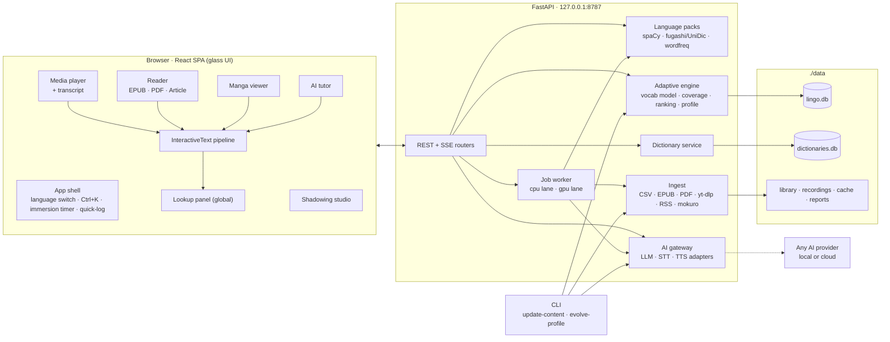
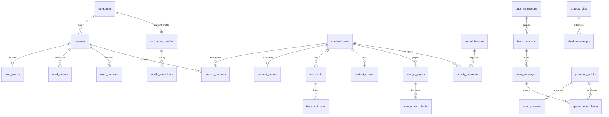

# Lingo OS: Architecture & Schema Plan (v1 draft)

> **Status:** proposal waiting for your confirmation. No application code has been written yet.
> **Companion file:** [`schema.sql`](schema.sql) has the full SQLite DDL. It is validated against SQLite 3.45, the version bundled with your Python.
> **Languages:** German (`de`), Spanish (`es`), Japanese (`ja`). Adding another language takes one DB row and one `LanguagePack` class.

---

## 0. Decisions to confirm

| # | Decision | Proposal | Main alternative |
|---|----------|----------|------------------|
| 1 | Backend | **Python 3.12 + FastAPI**, managed with `uv` | Node (Fastify). Rejected because the NLP, Whisper, yt-dlp and mokuro tools are all Python-native. |
| 2 | Frontend | **Vite + React 19 + TypeScript + Tailwind v4** single-page app | Next.js. Rejected because there is no SSR/SEO need, and it would add a second server process. |
| 3 | Database | **SQLite (WAL)** with SQLAlchemy 2 Core and numbered SQL migrations (`backend/app/db/migrations/{main,dict}/NNNN_*.sql`). A test keeps them identical to `docs/schema.sql`. `dictionaries.db` is a separate file. | Postgres, which is overkill for a single local user. |
| 4 | AI | **Provider-agnostic gateway** built on LiteLLM. Each task is routed to a model in `config/llm.yaml`. **Default provider: Gemini** (confirmed). | A hand-rolled OpenAI-compatible client only. |
| 5 | Runtime | One local server at `http://127.0.0.1:8787`, where FastAPI serves the built SPA. In dev mode, Vite and Uvicorn run side by side. | A Tauri desktop wrapper, which can be added later without changes. |
| 7 | Devices | **The laptop is the hub. The Android phone runs the same app as an APK (Capacitor) that works offline**, synced over home Wi-Fi after a one-time QR pairing (§6.13). Confirmed. | A small always-on cloud server as hub: sync works at any time, but your data leaves your machines and the server has a monthly cost. |
| 6 | Commands | Two ways in (confirmed): **`/lingo <mode>` inside an AI terminal** (Gemini CLI, Claude Code, Codex…) opened in the project folder, career-ops style (§7); and `npm run update-content · evolve-profile · import-csv` for headless or scheduled runs. Both call the same Python CLI `lingo`. | npm scripts only. |

---

## 1. Principles

1. **Zero context switching.** Every text surface (subtitles, EPUB, PDF, articles, manga bubbles and tutor replies) goes through **one** `InteractiveText` pipeline and opens **one** global Lookup panel. The immersion timer and the quick-log are global too.
2. **Local-first.** Everything lives in `./data`. The app works offline except for YouTube streaming and any cloud AI you choose to enable.
3. **AI-agnostic and AI-optional.** Every AI feature sits behind an interface. Every feature has a non-AI fallback: dictionary-only lookups, metrics-only weekly reports, and so on.
4. **Difficulty is measured, not labelled.** Difficulty comes from the item's *actual text* (subtitles, book text, OCR) compared against your word-level knowledge.
5. **Evidence first, LLM second.** The profile is computed from logged evidence (`word_events`, `activity_sessions`). The LLM writes narratives and proposes changes, and deterministic guardrails decide what is applied.
6. **No flashcards, ever.** There is no review queue, no spaced-repetition deck, no due counts and no Anki export. Saved words come back through *content*: the recommender favours items where your learning words reappear (§6.3), and the tutor works them into conversation. The Level Lab vocabulary test is a one-off measurement, not a drill.

---

## 2. Your machine (checked)

| Item | Found | Consequence |
|------|-------|-------------|
| GPU | RTX 4050 Laptop, **6 GB VRAM** | Local Whisper (`large-v3-turbo`) and mokuro manga OCR are practical. A local LLM is limited to roughly 7–8B quantized and competes for VRAM, so GPU jobs run in a **serial "gpu" lane**. |
| CPU / RAM | i5-13420H / 16 GB | spaCy `md` models and fugashi with full UniDic fit easily. |
| Node / Python / uv | 24.16 / 3.12.9 / 0.13.9 | Ready. |
| ffmpeg | 8.0 | Ready for clip extraction and audio conversion. |
| SQLite | 3.45.3 | Supports FTS5 trigram, partial indexes and JSON functions. |
| Ollama / LM Studio | not installed | Not needed: Gemini is the default for every AI task. A local model can be added later for offline use. |
| Existing tracker | `D:\Language-Immersion` (Node, CSV-backed) | Its CSVs are imported natively and can be re-synced until this app replaces it (§6.10). |

---

## 3. Tech stack

### Frontend (`frontend/`)
| Concern | Choice | Why |
|---|---|---|
| App | Vite + React 19 + TypeScript | Instant HMR. Builds to a static bundle that FastAPI serves. |
| Styling | Tailwind CSS v4 + CSS variables | Glass tokens and per-language accent themes. |
| Components | shadcn/ui (Radix primitives), restyled as glass | Accessible primitives, and the component code lives in the repo. |
| Routing / server state | TanStack Router + TanStack Query | Typed routes, caching and background refresh. |
| Client state | Zustand | Global stores for the player, lookup panel and tracker. |
| EPUB | **foliate-js** | Actively maintained. Supports vertical writing and RTL page order for Japanese, and CFI locators. |
| PDF | pdf.js (`pdfjs-dist`) text layer | Clickable text on PDFs. |
| Video | YouTube IFrame API (thin adapter) + HTML5 `<video>` | Both sit behind one `PlayerController` interface. |
| Audio UI | wavesurfer.js v7 + Regions plugin | A–B loops and the dual waveform in Shadowing. |
| Recording | MediaRecorder + Web Audio API. `@ricky0123/vad-web` is optional. | Push-to-talk by default, with hands-free voice activity detection (VAD) as an option. |
| Charts | ECharts | Immersion and vocabulary dashboards. |
| Misc | `cmdk` (Ctrl+K palette), Motion (transitions), `openapi-typescript` (typed API client) | |
| Android app | Capacitor + `@capacitor-community/sqlite` | The same React code shipped as an APK that works offline and syncs over Wi-Fi |

### Backend (`backend/`)
| Concern | Choice | Why |
|---|---|---|
| Web | FastAPI + Uvicorn. Server-Sent Events (SSE) for streaming. | Async. OpenAPI generates the frontend types. |
| Data | SQLAlchemy 2.0 (Core), plain SQL migrations, Pydantic v2 | The schema is authored in SQL, and SQLite's limited ALTER support makes an ORM migration tool add friction rather than safety. |
| CLI | Typer + Rich | `lingo update-content`, `lingo evolve-profile`, … |
| NLP: German, Spanish | spaCy `de_core_news_md`, `es_core_news_md` | Lemmas and POS. Reattaches German separable verbs and splits Spanish clitics. |
| NLP: Japanese | fugashi + **UniDic (full)** | Lemma, kana reading (furigana) and pitch-accent type. |
| Frequency | `wordfreq`, plus optional Yomitan frequency dicts | Word ranks for the vocabulary model. |
| Dictionaries | **Yomitan-format importer** | One format covers JMdict/Jitendex, KANJIDIC, pitch dicts, and the Wiktionary-derived de/es dicts (kaikki). |
| STT | faster-whisper (local GPU). Adapters for cloud STT. | |
| TTS | Adapters: VOICEVOX (ja, local), Piper (de/es, local), browser Web Speech (zero setup), cloud providers | Voice routing per language. |
| LLM | LiteLLM wrapped in our own `LLMClient` interface | Ollama, LM Studio, OpenAI, Anthropic, Gemini, OpenRouter, Groq, Mistral… |
| Media / web | yt-dlp, ffmpeg, trafilatura, feedparser, httpx | Subtitles, clip extraction, article extraction, feeds. |
| Documents | ebooklib + selectolax (EPUB text), pypdfium2 (PDF text) | Text extraction for analysis. Rendering happens in the browser. |
| Manga OCR | `mokuro` (manga-ocr + comic-text-detector), installed as an optional extra | Runs on the GPU lane. |
| Pronunciation | praat-parselmouth | Pitch contours for shadowing. |
| Prompts | Jinja2 templates with a version header | Versions take part in the cache keys. |
| Jobs | In-process worker on the `jobs` table, with `cpu` and `gpu` lanes | No Redis or Celery. |

---

## 4. System architecture



**Lifecycle of a content item:** `add` (user or scraper) → `extract_text` / `fetch_subtitles` / `transcribe` / `ocr_manga` job → `content_chunks` → `analyze_content` job (tokenize → `lexemes` + `content_lemmas`) → `rescore` (writes `content_scores` for the current profile version) → it appears on the shelf with a coverage badge.

---

## 5. Folder structure

```
my-languages/
├─ package.json                  # root scripts: setup, dev, start, update-content, evolve-profile, import-csv
├─ README.md
├─ .env.example                  # API keys only (OPENAI_API_KEY=…, ANTHROPIC_API_KEY=…); real .env is gitignored
├─ .gitignore                    # data/, .env, node_modules, .venv
├─ AGENTS.md                     # canonical instructions for AI terminals: project map, /lingo modes, guardrails
├─ GEMINI.md                     # Gemini CLI wrapper → imports AGENTS.md
├─ CLAUDE.md                     # Claude Code wrapper → imports AGENTS.md
├─ .gemini/commands/lingo.toml   # registers `/lingo <mode>` in Gemini CLI
├─ .claude/skills/lingo/SKILL.md # registers `/lingo <mode>` in Claude Code (same router text)
├─ modes/                        # one playbook per mode the AI terminal follows
│  ├─ _shared.md                 # data locations, calling `lingo … --json`, proposal/apply contract, guardrails
│  ├─ status.md  recommend.md  import.md  update-content.md
│  └─ evolve.md  plan-week.md  tutor-brief.md  doctor.md
├─ config/
│  ├─ app.yaml                   # data dir, enabled languages, tracker idle timeouts, ports
│  ├─ llm.yaml                   # AI providers + task→model routing + STT/TTS routing (§8)
│  ├─ sources.yaml               # curated channels/feeds/sites per language for update-content
│  └─ baselines.yaml             # hours→vocabulary prior curves, CEFR/JLPT band tables
├─ docs/
│  ├─ ARCHITECTURE.md            # this file
│  └─ schema.sql                 # full DDL
├─ scripts/
│  ├─ setup.ps1                  # uv sync, npm install, spaCy + UniDic model download
│  ├─ fetch-dictionaries.ps1     # optional: download recommended Yomitan dicts into data/dictionaries/
│  └─ schedule-windows.ps1       # registers Task Scheduler jobs for the two CLI commands
├─ backend/
│  ├─ pyproject.toml             # extras: [gpu] faster-whisper, [manga] mokuro, [pitch] parselmouth
│  ├─ app/
│  │  ├─ main.py                 # FastAPI app; mounts routers; serves frontend/dist in prod
│  │  ├─ cli.py                  # Typer app "lingo"
│  │  ├─ config.py               # loads config/*.yaml + .env
│  │  ├─ db/
│  │  │  ├─ session.py           # engine, PRAGMAs, UDF registration (p_model)
│  │  │  └─ models/              # one module per schema section
│  │  ├─ api/                    # routers: profile, content, media, reader, manga, nlp, dict,
│  │  │                          #          vocab, activity, imports, tutor, shadowing, jobs, settings, reports
│  │  ├─ languages/
│  │  │  ├─ base.py              # LanguagePack protocol: tokenize, lemma, reading, freq_rank, is_content_word
│  │  │  ├─ de.py                # spaCy + separable verbs + compound splitting
│  │  │  ├─ es.py                # spaCy + clitic splitting + verb morphology
│  │  │  ├─ ja.py                # fugashi/UniDic + deinflection chain + furigana + pitch
│  │  │  └─ frequency.py
│  │  ├─ dictionary/             # yomitan_importer.py, lookup.py, deinflect.py
│  │  ├─ ai/
│  │  │  ├─ gateway.py           # LLMClient / STTEngine / TTSEngine interfaces + task router
│  │  │  ├─ structured.py        # Pydantic → JSON schema, validation, repair retry
│  │  │  ├─ providers/           # litellm_llm.py, faster_whisper_stt.py, piper_tts.py, voicevox_tts.py, …
│  │  │  └─ prompts/             # *.j2 (lookup, tutor, postprocess, evolve, query_gen, tagging)
│  │  ├─ engine/
│  │  │  ├─ vocab_model.py       # P(known|rank) fit, per-word belief updates
│  │  │  ├─ coverage.py          # coverage, expected unknowns, learnability
│  │  │  ├─ ranking.py           # i+1 score + bands
│  │  │  ├─ profile.py           # builds User_Proficiency_Profile JSON, snapshots
│  │  │  ├─ grammar.py           # mastery updates from evidence
│  │  │  └─ evolve.py            # weekly batch (used by CLI)
│  │  ├─ ingest/                 # csv_importer.py, epub.py, pdf.py, article.py, youtube.py,
│  │  │                          # subtitles.py (vtt/srt/ass/json3), podcast.py, manga.py (mokuro)
│  │  ├─ discovery/              # update-content: query_gen.py, youtube.py, podcasts.py, rss.py,
│  │  │                          # gutenberg.py, aozora.py, pipeline.py
│  │  ├─ tracking/               # heartbeat merge, session sweeper, stats
│  │  ├─ tutor/                  # prompt_builder.py, session.py, governor.py, postprocess.py
│  │  ├─ shadowing/              # clips.py (ffmpeg), analysis.py (STT diff, pitch, DTW)
│  │  ├─ sync/                   # push/pull endpoints, hybrid logical clocks, conflict rules, offline-pack builder
│  │  └─ jobs/                   # queue.py, worker.py, handlers/
│  └─ tests/
├─ frontend/
│  ├─ package.json
│  ├─ vite.config.ts             # proxies /api → :8787 in dev
│  └─ src/
│     ├─ app/                    # router.tsx, providers.tsx, AppShell.tsx (rail · workspace · lookup dock)
│     ├─ api/                    # generated OpenAPI types + TanStack Query hooks
│     ├─ components/
│     │  ├─ glass/               # GlassPanel, GlassCard, GlassModal, Pill, tokens
│     │  ├─ interactive-text/    # InteractiveText, useTokenize, selection → phrase, furigana
│     │  ├─ lookup/              # LookupPanel, DictEntry, ContextGloss, GrammarBreakdown, SaveBar
│     │  └─ tracking/            # ImmersionTimerPill, QuickLogModal, useActivityTracker
│     ├─ features/
│     │  ├─ dashboard/           # today, recommendations (i+1 shelf), streaks, weekly report
│     │  ├─ library/             # shelf, filters, import (files/URL/YouTube)
│     │  ├─ player/              # PlayerController, YouTubeAdapter, Html5Adapter, TranscriptPane
│     │  ├─ reader/              # epub/ (foliate-js), pdf/ (pdf.js), article/
│     │  ├─ manga/               # MangaViewer, OcrOverlay, VolumeVocab
│     │  ├─ vocab/               # word list, contexts, status editing (a browser, not flashcards)
│     │  ├─ tutor/               # chat, voice loop, scenarios, session review
│     │  ├─ shadowing/           # clip list, loop/record, dual waveform, pitch overlay
│     │  ├─ imports/             # Immersion Tracker sync + CSV mapping wizard
│     │  ├─ level/               # Level Lab: adaptive tests, skill profile, exam anchors
│     │  ├─ stats/               # immersion & vocab charts
│     │  └─ settings/            # providers status, voices, dictionaries, tracking
│     ├─ sync/                   # outbox, push/pull, offline packs, QR pairing (Capacitor SQLite on Android)
│     ├─ lib/                    # recorder, subtitle parsers, hotkeys, locators
│     └─ styles/
├─ mobile/                       # Capacitor Android project: packages frontend/dist as an APK
└─ data/                         # gitignored; relocatable with LINGO_DATA_DIR
   ├─ lingo.db                   # personal data (WAL)
   ├─ dictionaries.db            # imported dictionaries (rebuildable)
   ├─ library/{books,pdf,media,manga,articles}/
   ├─ dictionaries/              # raw dictionary zips
   ├─ recordings/{tutor,shadowing}/
   ├─ cache/{tts,transcripts,thumbnails,clips}/
   ├─ imports/                   # original CSVs as uploaded
   ├─ reports/                   # weekly markdown reports (2026-W48.md)
   └─ backups/                   # `lingo backup` (SQLite online backup API)
```

---

## 6. Subsystems

### 6.1 InteractiveText: the shared pipeline
- `POST /api/nlp/tokenize { lang, segments:[{id,text}] }` returns, for each segment, tokens of the form `{surface, start, end, lemma, reading, pos, lexeme_id, status, p_known, is_word}`. The server keeps an LRU cache keyed by text hash. Segments are batched, so a whole subtitle file or EPUB section costs one request.
- `<InteractiveText>` renders token spans coloured by status: **unknown** gets an accent underline, **learning** an amber tint, **known** and **ignored** stay plain. Click opens a word lookup. Drag-selecting tokens opens a phrase lookup.
- It is mounted in: transcript cues, foliate-js section documents (through its section-load hook), the pdf.js text layer, manga text blocks, article HTML and tutor messages.
- Language-specific behaviour:
  - **de**: reattaches separable verbs ("Ich *rufe* dich morgen *an*" → `anrufen`), splits compounds as a lookup fallback (*Kranken·versicherungs·karte*), shows gender and plural.
  - **es**: splits clitics (*dámelo* → `dar` + `me` + `lo`), shows tense, mood and person from the morphology.
  - **ja**: lemma and reading from UniDic, a deinflection chain (*食べさせられた* → 食べる + causative + passive + past), pitch accent, kanji breakdown. Furigana can show on all words, unknown words only, or none.

### 6.2 Lookup engine (the side panel)
1. **Instant, local, <50 ms:** dictionary hits by lemma, then surface form, then Yomitan deinflection. Shows definitions, reading, pitch, gender, frequency rank and your status.
2. **Contextual, streamed and cached:** the `lookup.context_gloss` task gives the meaning *in this sentence* and a sentence translation. A grammar breakdown is available on demand.
3. **Audio:** TTS for the word and the sentence, cached in `data/cache/tts`. In the player, "replay original line".
4. **Seen in…:** other sentences from your own library that contain the lemma, found through FTS.
5. **Actions:** Save (→ `learning`), Known, Ignore, add a note. Each save captures `word_contexts`: the sentence, a locator to jump back, and a frame or panel crop where possible.
   In the player, clicking a word pauses the video, and closing the panel resumes it (configurable).

### 6.3 Adaptive engine and the `User_Proficiency_Profile`

**Word belief updates** (`user_words.p_known`):
| Evidence | Effect |
|---|---|
| Lookup | Strong evidence of *not known*: p ← p·0.5, `lookups++` |
| Save | status → `learning` |
| Exposure without lookup | Small Bayesian nudge upward that shrinks with repetition (aggregated per session) |
| Tutor: used correctly / misused | Strong upward / downward update |
| Mark known / ignore | p = 0.98 / excluded from coverage |
| Time | Slow decay for `learning` words not seen for weeks |

**Frequency model**, used for words you have never interacted with:
`P(known | rank r) = 1 / (1 + exp(k · (ln r − ln r50)))`.
`(r50, k)` are fitted per language by maximum likelihood over all evidence: Level Lab answers, explicit marks, lookups and exposures. `est_vocab_size = Σ P(r)` over the top 50k ranks. In SQL, this is a registered UDF `p_model(rank)`.

**Starting point:** §6.11 explains how the first estimate is built from your CSVs, the videos you actually watched, and the Level Lab tests.

**Level estimate:** vocabulary size and comfort map to CEFR bands, plus JLPT for Japanese, using tables in `baselines.yaml`. The estimate is always shown with a confidence value, because it is a heuristic, not a test score.

**Comfort per modality** is learned from behaviour: completion vs abandonment at a given coverage, lookups per 1k tokens, playback speed used, rewinds per minute and self-ratings.

**Profile document** (`proficiency_profiles.profile_json`, injected into the tutor and the scraper):
```json
{
  "language": "de", "version": 14, "updated_at": "2026-11-23T18:00:00Z",
  "level": { "cefr": "B1", "confidence": 0.62 },
  "vocabulary": { "estimated_size": 3400, "model": { "r50": 3150, "k": 1.6 },
                  "known_explicit": 1210, "learning": 340 },
  "comfort": { "reading": 0.72, "listening": 0.55, "speaking": 0.30, "comfortable_wpm": 140 },
  "targets": { "reading": [0.85, 0.95], "listening": [0.88, 0.97] },
  "immersion": { "total_hours": 412.5, "last_7d_hours": 9.2,
                 "by_modality": { "listening": 301.0, "reading": 98.5, "speaking": 13.0 } },
  "weak_grammar": [ { "key": "de.adj_endings.dative", "mastery": 0.35, "recent_errors": 7 } ],
  "recent_words": [ { "lemma": "Verantwortung", "status": "learning", "added": "2026-11-20" } ],
  "interests": ["technology", "history", "football"],
  "tutor_style": { "speech_rate": 0.9, "max_sentence_words": 14, "register": "du" }
}
```

**i+1 ranking**, computed from the content's actual lemmas:
```
p_w        = user_words.p_known if a row exists, else p_model(rank_w)   (proper nouns, numbers, punctuation excluded)
coverage   = Σ count_w · p_w / Σ count_w
E_unknown  = Σ_unique (1 − p_w)                         → "≈ 23 new words"
density    = E_unknown / minutes (AV)  or  E_unknown / (tokens/1000) (text)
listening  : coverage is penalised when speech_wpm > comfortable_wpm
band       = too_easy | comfortable | i_plus_1 | stretch | too_hard     (per-modality target band, default 85–95%)
fit        = exp(−((coverage − band_centre) / band_width)²)
learnability = share of the unknown mass on lemmas that are near your frontier AND repeated ≥3× in the item
reencounter = how many of your 'learning' words appear in the item, weighted by how long since you last met them
i1_score   = fit × (0.6 + 0.4·interest) × (0.8 + 0.2·learnability) × (1 + 0.15·min(reencounter, 4)) × density_penalty × freshness
```
- `content_lemmas` stores one histogram per item, so rescoring the whole library after a profile change is a single SQL pass.
- **Re-encounter instead of flashcards:** the `reencounter` term is the app's only "review" mechanism. Words you saved come back because you meet them again in real content you chose.
- **Up Next** shows **at least 10 picks** (default 12, configurable) per language, with diversity rules: at most 4 of one type, at most 2 from one channel or series, and at least one "stretch" and one "comfortable" item. `/lingo recommend` returns the same list with a reason for each pick.
- **Words to watch for:** an optional glance list for any item (its top unknown lemmas by `count × (1 − p)`). There are no drills; it is a list you can skim or ignore.

### 6.4 Media player
- `PlayerController` interface (play, pause, seek, rate, time events) with two adapters: **YouTubeAdapter** (IFrame API) and **Html5Adapter** (local files streamed by FastAPI with HTTP Range support).
- **Subtitle sources, in a configurable order:** manual subtitles (yt-dlp) → your `.srt/.vtt/.ass` → YouTube auto-captions (available instantly, flagged as low quality) → **Whisper job** on the GPU lane. Whisper output replaces auto-captions when it finishes, and its word timings drive karaoke highlighting.
- **Transcript pane:** auto-scroll, click a line to seek, active-word highlight, an optional translation track blurred until hover, **sentence-mining mode** (auto-pause at the end of each line) and A–B loop. Keys: `←/→` previous/next line, `R` replay the line, `S` send the line to Shadowing, `Space` play/pause.
- YouTube iframes are cross-origin, so the app cannot grab video frames from them. Saved words store the timestamp locator instead. Local media gets an ffmpeg frame grab.

### 6.5 Reader (EPUB, PDF, web articles)
- **Shelf:** covers, progress, a coverage badge ("93% known"), a band chip, and filters by language, type and band.
- **EPUB** via foliate-js: paginated or scrolled, `vertical-rl` with RTL page order for Japanese, and font, size and theme controls. **PDF** via pdf.js with its text layer. **Articles:** paste a URL, trafilatura extracts clean HTML, and it opens in the same reader shell. Pasting raw text also works.
- Tokenization is lazy (visible section only), with status colouring, a furigana toggle, highlights and bookmarks (`annotations`).
- Scanned PDFs with no text layer are flagged. OCR for them is a later phase.

### 6.6 Manga (inspired by mokuro)
- **Import:** a CBZ, a ZIP, a folder of images, or existing mokuro output (`.mokuro` + images). Anything dropped into `data/inbox/manga/`, or into a folder you choose such as Downloads, is imported automatically. Volumes that already include `.mokuro` OCR skip the GPU step.
- **Mokuro Bunko (catalog.mokuro.moe → mokuro.moe):**
  - The Manga screen has a **Catalog** button that opens the site beside the app, signed in with your own account. Browsers usually block sign-ins inside embedded frames, so the optional desktop wrapper is what can embed it directly.
  - When you download a volume there (if the site offers downloads), it lands in the inbox folder and appears on your shelf with its OCR text, its coverage score and its place in the series.
  - The app never crawls or bulk-downloads the site, because its `robots.txt` disallows all automated access. If the operator offers an API or export, a direct integration can be added.
- **OCR job** (GPU lane) runs mokuro and stores the text blocks with line coordinates in `manga_pages` / `manga_text_blocks`. The text also goes to `content_chunks` for analysis and search.
- **Viewer:** single or two-page spread, RTL, fit modes, zoom and pan. An invisible text layer sits over the speech bubbles and appears on hover. Clicking a word opens the Lookup panel. OCR errors can be corrected inline.
- **Vocabulary browser:** per volume or series, unknown words ranked by frequency in that volume, with page jumps. Includes a "pre-read volume N" list and a series coverage curve showing each volume getting easier.

### 6.7 Shadowing studio
- Create a clip from any transcript line (`S`) or an A–B selection. The reference audio is extracted with ffmpeg (local media), downloaded for just that time range with yt-dlp (YouTube), or rendered with TTS as a fallback.
- **Loop modes:** listen → a pause sized to the clip for your turn → repeat, at 0.5–1.0× speed.
- **Record** with MediaRecorder. Shows **dual wavesurfer waveforms** aligned, with A/B and overlay playback.
- **Analysis:** STT of your attempt gives a word-diff against the reference text (missed words highlighted). Parselmouth extracts a **pitch contour overlay**, which is especially useful for Japanese pitch accent. DTW measures the timing offset.
- Attempt history is kept per clip, and practice is tracked as *speaking*.

### 6.8 AI conversational tutor
- **Cascaded voice loop, which works with any provider:** mic (push-to-talk or VAD) → STT → LLM (streamed) → sentence chunker → TTS (streamed) → playback. Text-only mode is also available. A realtime speech-to-speech adapter can be added later behind the same session tables.
- **System prompt assembly**, rendered per session and stored verbatim in `tutor_sessions.system_prompt`:
  ```
  [tutor.base.j2]          persona, target-language-only, recast corrections, ask follow-ups
  [live profile block]     level · vocab size · comfortable sentence length · speech rate
                           weak grammar (top 3) → create natural chances to use them
                           focus words this week (≤15) + recently learned (14 d) → reuse naturally
                           "aim for ≥95% words I know; make any new word guessable from context"
                           interests → topic seeds
  [weekly brief]           tutor_instructions.instructions_md  (written by evolve-profile)
  [mode / scenario]        conversation · roleplay card · discuss <content item> · grammar drill
  [output contract]        plain speakable text; no markdown
  ```
- **Vocabulary governor:** each tutor reply is tokenized and its coverage is measured against *your* known words. If it falls below the speaking band, the reply is automatically rewritten once in simpler language. Unknown words in replies stay clickable and are logged as `tutor_heard`. This keeps difficulty consistent even with weaker models.
- **Speed and complexity:** TTS rate comes from `style.speech_rate`, and the prompt enforces `max_sentence_words`.
- **Post-session processing** (`tutor_postprocess` job, structured output) extracts:
  - corrections as `[{original, corrected, grammar_key, explanation}]`
  - target words used correctly or incorrectly
  - a session summary

  The results update `user_words`, `user_grammar` and `grammar_evidence`. Keeping this outside the chat call means the chat model never has to emit JSON.
- **Modes:** free conversation, role-play cards (ordering at a café in Madrid, an appointment at a German government office, a convenience-store exchange in Japan), discussion of a video or book you just finished (seeded with its vocabulary), and drills on weak grammar. Correction style is a setting: recast, inline, or end-of-session.

### 6.9 Dual immersion tracker
- **Automatic:** each module uses `useActivityTracker({activity, contentId})` and sends a heartbeat every 15 s while it is *active*:
  | Activity | Counted while |
  |---|---|
  | Video / audio | playing **and** tab visible |
  | Reading / manga / article | visible **and** scroll, page turn or pointer input within the idle window (90 s default, scaled by page length) |
  | Tutor | session open **and** last turn < 3 min ago |
  | Shadowing | looping or recording |

  The server merges heartbeats into open `activity_sessions`. Each heartbeat credits at most 20 s, a gap of more than 45 s starts a new session, and a sweeper closes stale sessions. Every heartbeat is persisted, so a crash loses at most 15 s.
- **Manual:** a quick-log modal (`Ctrl+L` or the timer pill's `+`) with language, activity, duration presets, start time, title, notes and difficulty.
- **Timer pill**, always visible: today's total for the current language, a live indicator, and a pause-tracking toggle.
- **Stats:** daily and weekly charts by language and modality, streaks, goals, and lifetime hours including imported history.

### 6.10 CSV importer
**Native format: your Immersion Tracker** (`D:\Language-Immersion\data\immersion_log_{de,es,ja}.csv`). The importer recognises it from its header and needs no mapping step:

| Tracker column | Becomes |
|---|---|
| `entry_id` | `activity_sessions.external_ref`, so re-syncing never double-counts. You can keep using the old tracker until this app replaces it. |
| `kind=baseline` | One "pre-tracking" session per language. It has no date or content, counts toward total hours, and stays out of daily charts. |
| `kind=session` + `category` | `youtube` / `watching` / `listening` → listening · `reading` → reading · `speaking` → speaking |
| `date` | The session date. `logged_at` is not used for dating, because many rows are logged days after watching. |
| `video_id`, `url`, `title`, `channel` | A `content_items` row (status `finished`) plus a `collections` row per channel. This lets the video's subtitles be analysed (§6.11). |
| `duration_seconds` | `active_seconds`. The tracker logs the full video length, so this assumes the whole video was watched. |
| `data/settings.json` goals | `goals` (minutes per day per language) |

Cleaning rules:
- A video logged twice on the same day, within less time than its own length, is flagged as a probable double-log and shown to you before it is counted.
- Rewatches on different days count as time, but not as new content.
- A URL pasted into the title field is moved to `url`.

**Other CSVs** go through a mapping wizard: preview → auto-detected columns (header synonyms; durations such as `1:30:00`, `90`, `1.5h`) → confirm. Unmapped columns are kept in `import_rows.raw_json`.

`lingo import-csv` and `/lingo import` re-sync the tracker folder at any time, and any import batch can be reverted.

### 6.11 Initial level estimate from your CSVs
Hours alone are a weak signal. The first estimate is built in four layers, and each layer narrows the range:

1. **Hours prior, adjusted for language difficulty.** Total hours are converted to "Spanish-equivalent hours" with multipliers from `config/baselines.yaml`: es ×1.0, de ÷1.33, ja ÷3.0. These are the FSI course-length ratios for English speakers, and you can edit them. The result is placed on your tracker's 7-level roadmap (0/50/150/300/600/1000/1500 h), and the roadmap's word counts give the vocabulary prior. Confidence at this stage is low.
2. **Content evidence from the videos you actually watched.** Subtitles are fetched for every logged `video_id` (yt-dlp, or Whisper on the GPU when none exist) and lemmatised. This produces three things:
   - An **exposure map**: how often you have heard each word in tracked time. Words met 10 or more times in understandable context are probably acquired. Words met 3–9 times are partially acquired.
   - **How hard the content you keep watching is**: coverage, speech rate and word-frequency profile per video and per month, plus the hardest content you finish repeatedly.
   - A **reverse estimate**: the vocabulary size whose N most frequent words cover about 85–90% of the tokens in your usual content.

   Learner channels often show on-screen subtitles and translations, so this layer is treated as an upper bound.
3. **Bayesian combination.** The hours prior and the content evidence are combined into `(r50, k)` with a confidence value, weighted by how much evidence each language has. German has about 160 tracked videos, Spanish 13, and Japanese none, so Japanese relies on hours only.
4. **Level Lab tests (§6.12).** Short adaptive tests replace guesses with measurements. Japanese needs them most, because it has no content evidence.

Layers 1–3 produce a starting range, and layer 4 measures it. After that, how you use the app keeps the estimate current: lookups, finished and abandoned items, tutor turns, and the weekly `evolve` recalibration. Every estimate is shown as a range with a confidence value.

### 6.13 Laptop + Android phone, with sync
**Model: the laptop is the hub, and the phone is a full client that also works offline.**

| | Laptop (hub) | Android phone |
|---|---|---|
| What runs | Everything: the server, NLP, Whisper, manga OCR, content discovery, Gemini calls, and the authoritative database | The same React app, packaged as an **Android APK with Capacitor** and installed straight from the file (no app store). The UI ships inside the APK, so it opens and works with no connection. It uses native SQLite and app storage, and background audio and the microphone work without certificate setup. |
| Connection | — | **Your home Wi-Fi** (confirmed). Pair once by scanning a QR code on the laptop. The code carries the laptop's address, a device token and an encryption key, so sync traffic is authenticated and encrypted without any certificates. Only the sync endpoints listen on the network; the rest of the server stays bound to the laptop itself. Tailscale can be added later if you ever want to sync away from home. |
| Layout | Desktop layout | Phone layout from the same code: the rail becomes a bottom bar, and the lookup panel becomes a bottom sheet |

**How sync works**
*(A browser-installed PWA was considered instead of the APK. Android requires HTTPS both to install one and to use the microphone, which is awkward on a home network.)*

1. Every change made on the phone is written first to an **outbox** in on-device SQLite, so nothing is lost offline. This covers lookups, saved words, status changes, progress, timer sessions, manual logs, annotations, tutor turns and shadowing attempts.
2. Whenever the phone is on the same Wi-Fi as the laptop, it pushes the outbox (`POST /api/sync/push`). It checks when the app opens or resumes, and every few minutes while it is open. Each event carries a unique id, so a retry never double-counts, plus a hybrid-logical-clock timestamp.
3. The phone then pulls everything newer than its last sync (`GET /api/sync/pull?since=<seq>`): changes made on the laptop, new Up Next picks and refreshed packs.
4. **Conflicts:**
   - Append-only records (time sessions, lookups, tutor messages) simply merge.
   - Editable values (a word's status, your position in a book) use last-writer-wins by clock, per field.
   - Overlapping timer sessions from two devices are counted once in the stats.

**Offline packs.** "Make available offline" asks the laptop to build a pack for an item. It contains:
- the text, already split into words with lemmas and your current word statuses
- dictionary entries for every word in the item (a small subset of the full dictionaries)
- audio, or the local video file where there is one
- manga pages with their OCR boxes

Up Next's top picks can be packed automatically each night. YouTube videos only stream, so they cannot be saved offline. A manga volume pack is roughly 50–150 MB, and a book or article pack a few MB.

**Needs the laptop:** importing and analysing new content, Whisper transcription, manga OCR, `update-content`, `evolve-profile`, and Level Lab speaking scores.

**Works without it:** reading and listening to offline packs, lookups, saving words, the timer and manual logging. Contextual glosses and the tutor can optionally call Gemini directly from the phone, using Android speech recognition, with the key stored only on that phone. Everything syncs when the laptop is back.

### 6.12 Level Lab: measuring your level accurately
No single "exact level" exists. CEFR describes separate skills, and someone with 500 hours of anime can be B2 at listening and A1 at speaking. The Level Lab therefore measures **five skills separately**. Each skill gets a score with an error bar, and the CEFR or JLPT band is derived from those scores.

| Skill | Test (adaptive, auto-scored) | Time | Why it is accurate |
|---|---|---|---|
| Vocabulary | Adaptive test over the frequency list. Every "yes" is verified: pick the meaning from 4 options, or, for Japanese kanji words, type the reading. Pseudo-words catch guessing. | 4–6 min | Item Response Theory (IRT) always asks at your frontier. The verification and pseudo-word correction remove over-claiming. The test stops when the 95% interval is narrow enough. |
| Listening | Dictation of short clips at rising speed and difficulty, scored as word error rate, plus comprehension questions on a longer clip | 6–8 min | Dictation is objective, with no self-rating, and closely tracks listening ability. The speed steps measure your comfortable words per minute directly. |
| Reading | **C-test**: in short texts, the second half of every second word is deleted and you restore it (Japanese uses a character-level variant). Plus a timed passage for reading speed. | 5–6 min | C-tests are an established, highly reliable proficiency format, used by German placement tests such as onSET. Scoring is exact. |
| Speaking | **Elicited imitation**: repeat sentences of increasing length (scored with STT), then a 5-minute tutor conversation | 8 min | Elicited imitation correlates strongly with oral proficiency. The conversation adds objective fluency metrics from Whisper timestamps (speech rate, pause length, mean length of run), accuracy (errors per 100 words) and lexical range. An LLM rubric based on CEFR descriptors is one input among these, not the only one. |
| Grammar | Targeted items from a CEFR/JLPT grammar inventory, built from real sentences in your library | optional | Pinpoints weak structures, which then feed the tutor. |

**The model behind it**
- Each skill has a latent ability **θ with a standard error** (`skill_estimates`).
- IRT chooses each next item where it is most informative and updates θ after every answer.
- Between tests, θ drifts with immersion and behaviour evidence, while its uncertainty grows slowly. This works like a Kalman filter.
- The app suggests a re-test when the uncertainty crosses a threshold, about monthly, rather than on a fixed calendar.

**Mapping to CEFR and JLPT**
- θ is mapped to bands using anchors: graded content with known levels, the level labels on learner videos, and above all **official results**.
- When you enter a Goethe, telc, DELE, SIELE or JLPT result, or an official placement-test score, that anchor re-calibrates the mapping for that language.
- Without such anchors, the mapping uses published vocabulary-size and text-coverage thresholds, and the app shows lower confidence.

**What the app reports:** one line per skill, for example *"Listening B1, 90% likely between A2+ and B1+"*, plus vocabulary size with an interval. It never reports a single unexplained label.

**Measured precision (Phase 1 simulations).** One vocabulary test of about 38 words plus 7 pseudo-words recovered a simulated learner's true vocabulary within about 5%. Its 90% range is roughly ±35% (for example 1,980–4,310 around an estimate of 2,990). The range narrows with every retest, with lookup and reading evidence in the app, and with each official exam you add. The app always shows the range, not just the point estimate.

---

## 7. CLI automation

Root `package.json` scripts call the Python CLI, so both forms work:

| npm | Python | Purpose |
|---|---|---|
| `npm run setup` | `scripts/setup.ps1` | Install everything and download the NLP models |
| `npm run dev` | Vite + `uvicorn --reload` (via `concurrently`) | Development |
| `npm run start` | `uv run lingo serve` | Build the SPA and serve everything on :8787 |
| `npm run update-content -- --lang ja --limit 30` | `uv run lingo update-content …` | Content discovery |
| `npm run evolve-profile -- --days 7` | `uv run lingo evolve-profile …` | Weekly recalibration |
| `npm run import-csv -- path\to\log.csv` | `uv run lingo import-csv …` | Headless import |
| | `lingo backup`, `lingo dict import <zip>`, `lingo reanalyze`, `lingo doctor` | Maintenance |

### Agent mode: `/lingo` inside an AI terminal (career-ops style)
Open Gemini CLI, Claude Code or Codex in the project folder and type:

| You type | What happens |
|---|---|
| `/lingo` | Menu of modes plus a one-screen status for each language |
| `/lingo status de` | Hours, streak, per-skill level with confidence, vocabulary, and what changed this week |
| `/lingo recommend ja` | Top i+1 items from the library, each with the reason it was chosen |
| `/lingo update-content es` | Content discovery (below). The terminal AI's own web search is an extra source. |
| `/lingo evolve` | Weekly recalibration and report (below), reasoned by the terminal AI |
| `/lingo import` | Re-sync the Immersion Tracker CSVs |
| `/lingo plan-week` · `/lingo tutor-brief` · `/lingo doctor` | Plan the week from goals and gaps · edit next week's tutor brief · check the environment |

**How it works**
- `AGENTS.md` holds the canonical instructions, and `GEMINI.md` and `CLAUDE.md` import it.
- `.gemini/commands/lingo.toml` and `.claude/skills/lingo/SKILL.md` route `/lingo <mode>` to `modes/<mode>.md`.
- **The terminal AI does the reasoning, and scripts do the deterministic work.** Every mode follows the same loop:
  1. Call `uv run lingo <cmd> --json` to get the facts: metrics, candidates, profile.
  2. Reason over them and write a proposal file.
  3. Hand it back with `uv run lingo <cmd> --apply proposal.json`. This step validates the proposal against a schema and the guardrails before it writes anything.

  The AI never edits SQLite directly.
- The same commands also run **headless** with `npm run evolve-profile`. In that case the app calls Gemini itself through `config/llm.yaml`, which is how Task Scheduler runs them unattended.

### `update-content`
1. Load each language's profile: frontier, target bands, interests, modality comfort, active sources.
2. **Generate queries:** interests × per-language templates. `content.query_gen` (LLM, optional) writes natural queries in the target language, for example *"Raumfahrt einfach erklärt Dokumentation"*. Without an LLM, templates are used.
3. **Fetch candidates:**
   - YouTube via yt-dlp search plus recent uploads from subscribed channels. No API key is needed. Filters: has subtitles in the target language (manual preferred), duration range, embeddable.
   - Podcasts via the iTunes Search API → RSS feeds. Episodes are preferred when they carry a transcript; otherwise a Whisper job is queued when the episode is opened.
   - Articles via curated RSS feeds per language (`config/sources.yaml`) and trafilatura.
   - Public-domain books from Project Gutenberg (de/es) and Aozora Bunko (ja).
   - **Comprehensible Input Wiki** (`comprehensibleinputwiki.org`; its content is CC0):
     - `lingo sources sync-wiki` reads only the public `/wiki/German`, `/wiki/Spanish` and `/wiki/Japanese` pages, at most once a week, with caching. It follows robots.txt, which disallows the wiki's API, so the API is not used.
     - Each listed channel, podcast or site becomes a `content_sources` row with `origin='ci_wiki'`. Its type comes from the page's icons, its `level_label` from the section heading or note (CEFR, JLPT, "Intermediate"), and it is flagged for paid, AI-generated and has-captions.
     - Paid or app-only resources are shown as links but never fetched.
     - Wiki level labels are only a starting hint. Items are still ranked by the coverage of their actual text.
4. **Analyse each candidate** (subtitle text, article body or a sample chapter) → `content_lemmas` → score.
5. Keep the top N per language that land in or near the i+1 band, with `status='candidate'` and `content.tagging` topics. Stale or low-scoring candidates older than 30 days are pruned.
6. Print a Rich table summary. The run is logged in `scrape_runs`. Requests are rate-limited and cached. `--dry-run` writes nothing.

### `evolve-profile`
1. **Deterministic metrics** for the window (default 7 days), per language:
   - minutes by activity and modality
   - words saved, and words promoted to known
   - lookup rate per 1k tokens, *bucketed by item coverage*: this is the calibration signal for the band
   - completion vs abandonment by band
   - tutor turns, error categories and focus-word usage
   - shadowing attempts and scores
2. **Statistical refit** of the vocabulary model `(r50, k)` and of the modality comfort values.
3. **Band calibration with guardrails:** if you finish items easily at the top of the band with few lookups, the band shifts toward harder content. If abandonment is high or lookups spike, it shifts toward easier content. The band moves at most **±2 percentage points per week**, every change is recorded in `adjustments_json` with its reason, and the result is always clamped to a sane range.
4. **LLM pass** (`profile.evolve`, structured output): the input is the metrics JSON, a token-budgeted sample of tutor transcripts and corrections, and the grammar evidence. The output is `{narrative_md, weak_grammar_updates, focus_words, focus_grammar, tutor_instructions_md, style_adjustments, suggested_goals}`. The LLM's suggestions are only *proposals*. Numeric changes still go through the guardrails in step 3.
5. **Writes:**
   - a new `profile_snapshots` row and a version bump, which triggers a library rescore
   - a new active `tutor_instructions` version
   - a `progress_reports` row and `data/reports/2026-W48.md`
   - a console summary
6. `--no-llm` produces a metrics-only report and still applies the deterministic adjustments.

**Scheduling:** `scripts/schedule-windows.ps1` registers Windows Task Scheduler entries: `update-content` daily at 06:00 and `evolve-profile` on Sundays at 21:00. Both commands work whether or not the app is running, because WAL mode allows concurrent access. The dashboard shows a "weekly report ready" card.

---

## 8. AI provider layer (model-agnostic)

- **Interfaces:** `LLMClient.complete / stream / structured(schema)`, `STTEngine.transcribe(audio, lang, word_timestamps)`, `TTSEngine.synthesize(text, lang, voice, rate)`. Feature code only ever names a **task**, never a provider or model.
- **Routing:** `config/llm.yaml`. Model names below are placeholders that you choose:
  ```yaml
  providers:
    cloud:  { kind: gemini, api_key_env: GEMINI_API_KEY }              # default. Swap for openai / anthropic / openrouter / groq …
    local:  { kind: ollama, base_url: http://localhost:11434 }         # optional, for offline use
  # Gemini: a Flash-class model for fast tasks, a Pro-class model for profile.evolve
  tasks:
    lookup.context_gloss:   { use: cloud, model: <fast-cheap-model>,   temperature: 0.2, fallback: [local] }
    lookup.grammar:         { use: cloud, model: <fast-cheap-model> }
    tutor.chat:             { use: cloud, model: <conversational-model>, temperature: 0.7 }
    tutor.postprocess:      { use: cloud, model: <fast-cheap-model> }
    content.query_gen:      { use: cloud, model: <fast-cheap-model> }
    content.tagging:        { use: cloud, model: <fast-cheap-model> }
    level.speaking_rubric:  { use: cloud, model: <strongest-model>, temperature: 0 }
    profile.evolve:         { use: cloud, model: <strongest-model> }
  stt:
    default: { kind: faster_whisper, model: large-v3-turbo, device: cuda, compute_type: int8_float16 }
  tts:
    ja: { kind: voicevox, base_url: http://localhost:50021, speaker: <id> }
    de: { kind: piper, voice: <de-voice> }
    es: { kind: piper, voice: <es-voice> }
    fallback: { kind: browser }        # Web Speech API, zero setup
  ```
- **Structured output:** Pydantic model → JSON schema. Native JSON or structured mode is used when the provider supports it. Otherwise the call is prompt → validate → one repair retry.
- **Prompts** are text files with a version header and `$variables` (`backend/app/ai/prompts/`). The task, model, prompt version and input form the `ai_cache` key, so changing a model or prompt never serves stale results.
- **Resilience:** per-task fallback chains, timeouts, and every call logged in `ai_calls` (latency, units, estimated cost). The UI shows a "degraded: dictionary-only" badge instead of breaking.
- **Local-only mode:** a single switch routes every task to local providers. Only the text a task needs is ever sent out.

---

## 9. Database schema

Full DDL with comments: **[`schema.sql`](schema.sql)**. It has 44 tables in `lingo.db`, 4 in `dictionaries.db`, 1 FTS index and 3 views. It was validated by executing it, by a coverage smoke test, by an FTS trigram search on Japanese text, and by the single-active-instructions constraint.

| Domain | Tables |
|---|---|
| Languages & settings | `languages`, `app_settings` |
| Profile & progress | `proficiency_profiles`, `profile_snapshots`, `progress_reports`, `goals`, `interests` |
| Level Lab | `assessments`, `assessment_items`, `skill_estimates` |
| Vocabulary | `lexemes`, `user_words`, `word_contexts`, `word_events` |
| Dictionaries (`dictionaries.db`) | `dictionaries`, `dict_terms`, `dict_term_meta`, `dict_kanji` |
| Library | `collections`, `content_sources`, `content_items`, `annotations` |
| Text & media | `transcripts`, `transcript_cues`, `content_chunks` (+ `content_fts`), `manga_pages`, `manga_text_blocks` |
| Analysis & ranking | `content_analysis`, `content_lemmas`, `content_scores` |
| Tracking & import | `activity_sessions`, `import_batches`, `import_rows` |
| Tutor & grammar | `tutor_instructions`, `tutor_sessions`, `tutor_messages`, `grammar_points`, `user_grammar`, `grammar_evidence` |
| Shadowing | `shadow_clips`, `shadow_attempts` |
| Automation | `scrape_runs`, `jobs`, `ai_cache`, `ai_calls` |
| Multi-device sync | `devices`, `sync_log`, `offline_packs`, plus `client_uuid` / `*_hlc` columns on rows the phone can create or edit |
| Views | `v_daily_immersion`, `v_vocab_summary`, `v_library_ranked` |



**Key design notes**
- **`lexemes` are created lazily** for every lemma in any analysed content. Word identity is `(language, lemma, reading)`. Reading matters only for Japanese homographs such as 方 (かた/ほう).
- **No `user_words` row means no interaction**, so P(known) comes from the frequency model. This keeps the table small and the model honest.
- **`content_lemmas`** (a `WITHOUT ROWID` histogram) is what makes "go through the content itself" cheap: coverage for any profile state is one join.
- **The profile is versioned.** `content_scores.profile_version` shows which scores are stale. Snapshots give charts and rollback.
- **Single FTS index with a trigram tokenizer** over all text, including Japanese with no spaces. It powers "seen in…", library search and the manga vocabulary browser.
- **Dictionaries live in a separate DB**: they are large, rebuildable and licence-tagged (`attribution`), and they stay out of personal-data backups.
- **Imports are idempotent** (`external_ref` partial unique index) and revertible (`import_batches` cascade).
- At most one active weekly tutor brief per language is enforced by a partial unique index.

---

## 10. API surface (FastAPI routers)

| Router | Key endpoints |
|---|---|
| `/api/profile` | `GET /{lang}`, `POST /{lang}/recompute`, `GET /{lang}/history` |
| `/api/level` | `POST /{lang}/{skill}/start`, `POST /assessments/{id}/answer` (returns the next adaptive item), `POST /{lang}/external-result`, `GET /{lang}/skills` |
| `/api/imports` | `POST /csv` (upload → preview + guessed mapping), `POST /csv/{batch}/commit`, `POST /csv/{batch}/revert` |
| `/api/content` | list/filter/rank, `GET /up-next?lang=&n=12` (≥10 diverse picks), `POST` (file / URL / YouTube), `GET /{id}`, progress, status, words-to-watch-for list |
| `/api/media` | `GET /{id}/stream` (Range), `GET /{id}/transcripts`, `POST /{id}/transcribe` |
| `/api/reader`, `/api/manga` | sections/pages, annotations, OCR text edits, volume vocabulary |
| `/api/nlp` | `POST /tokenize`, `POST /lookup` (dictionary tier), `GET /lookup/context` (SSE, LLM tier) |
| `/api/vocab` | list/search, `PUT /{lexeme}` (status, gloss, note), contexts, export (CSV) |
| `/api/activity` | `POST /heartbeat`, `POST /manual`, `GET /stats`, `GET /today` |
| `/api/tutor` | sessions CRUD, `POST /{id}/turn` (SSE text + TTS chunk URLs), `POST /stt`, `GET /{id}/review` |
| `/api/shadowing` | clips CRUD, `POST /clips/{id}/attempts` (upload → analysis) |
| `/api/jobs` | list, `GET /events` (SSE progress), cancel |
| `/api/sync` | `POST /pair` (QR pairing), `POST /push` (outbox events), `GET /pull?since=` (changes since the last sync), `POST /offline/{content_id}` (build an offline pack), `GET /devices` |
| `/api/settings`, `/api/reports`, `/api/dict` | provider health, voices, dictionary import, weekly reports |

---

## 11. UI: glass design system

```
┌────────────────────────────────────────────────────────────────────────────┐
│ [DE] [ES] [JA]    Ctrl+K  Search everything…        ⏱ 1h 12m today ● Reading  [+] │  ← glass top bar
├──────┬───────────────────────────────────────────────────┬─────────────────┤
│ Home │                                                   │  Lookup         │
│ Watch│              Workspace                            │  (glass dock,   │
│ Read │   solid, high-contrast surface for the content    │   slides in on  │
│ Manga│   (video · page · manga spread · chat)            │   click; pinned │
│ Speak│                                                   │   or floating)  │
│ Vocab│                                                   │                 │
│ Stats│                                                   │                 │
└──────┴───────────────────────────────────────────────────┴─────────────────┘
```
- **Glass goes only on the chrome**: rail, top bar, docks, modals, pills, using translucent fills, `backdrop-blur`, hairline borders and soft inner highlights. **Content surfaces stay solid** so text keeps full contrast. Long reading on frosted glass is tiring.
- **Per-language ambience:** the active language tints a slow ambient gradient behind the glass (amber for de, coral for es, indigo for ja) so you always know which language mode you are in.
- **Dark-first, with a light theme.** Glass falls back to solid surfaces under `prefers-reduced-transparency` and on low-power devices, since blur costs GPU time. Animations respect `prefers-reduced-motion`.
- **Type:** Inter for the UI, Literata for Latin-script reading, Noto Sans JP and Noto Serif JP for Japanese, with ruby support for furigana.
- **Keyboard-first:** Ctrl+K palette (open anything, switch language, log time), `Ctrl+L` quick-log, and player and reader shortcuts listed in `?`.

---

## 12. Build phases (after you approve)

Each phase ends with something you can use.

| Phase | Scope | Usable result |
|---|---|---|
| **0** ✅ | Scaffold, config, SQL migrations from `schema.sql`, glass app shell (desktop and phone layouts), language switcher, `npm run dev/start`, sync-ready IDs and clocks from day one. **Pulled forward from Phases 1–2:** the Immersion Tracker importer, manual time logging, the Today dashboard on real data, and `/lingo status`, `import` and `doctor`. | Done 2026-11-23 |
| **1** ✅ | Language packs (spaCy de/es with separable-verb and clitic handling; fugashi + UniDic-lite ja with verb grouping), Yomitan dictionary import (Jitendex, Wiktionary de/es: 2.5 M entries stored as compact glosses), InteractiveText + global Lookup panel, vocabulary store with saved sentences, starting profile from hours, **Level Lab: adaptive vocabulary test (meaning-verified, pseudo-words) and C-test (de/es)**. Deferred: Japanese C-test variant, furigana, German compound splitting, exam-anchor entry. | Done 2026-11-23 |
| **2** ✅ | Media player (YouTube IFrame + local files with Range streaming), captions via yt-dlp (uploaded tracks, then YouTube's own-language automatic captions rebuilt into sentences), `.srt`/`.vtt` for local media, per-item analysis and coverage (all running words), heartbeat tracking with a live timer, background job runner, **history evidence from your watched videos** (exposure counts + vocabulary your videos need, blended into the starting estimate), **Level Lab dictation** with browser voices (graded A1–C1 sentences; Japanese scored by kana). Deferred: Whisper (you chose to skip the download), A–B loop, translation track. | Done 2026-11-23 |
| **3** ✅ | Reader (EPUB with ruby stripped, PDF text layer, web articles via trafilatura, pasted text) split into pages, per-page coverage, sentence-level context for saved words, reading tracker (active while you interact), resume position and progress. **Up Next**: 12 picks ranked by i+1 fit × re-encounters of your learning words × freshness, with variety rules that loosen step by step. Background analysis job for whole books. Fixed along the way: "words needed for 90%" now counts running words, like item coverage. Deferred: OCR for scanned PDFs, furigana in the reader. | Done 2026-11-24 |
| **4** ✅ | AI gateway (`backend/app/ai/`): Gemini over REST plus any OpenAI-compatible server (Ollama, OpenRouter, LM Studio), task routing with fallbacks and `local_only`, `ai_cache` + `ai_calls`, JSON validated against Pydantic with one repair retry. Lookup panel: meaning in this sentence (automatic, cached, marks the dictionary sense that fits), translation on request, grammar breakdown on request, sentence playback. Settings: status, connection test, usage. `lingo ai status|test|models`. Without a key everything stays dictionary-only. Deferred: neural TTS voices (browser voices for now), grammar tracking from lookups (Phase 6 with the seeded catalog). | Done 2026-11-24 |
| **5** ✅ | Manga: import of mokuro output (`.mokuro` + images, older `_ocr/` page files), image folders and `.zip`/`.cbz`, from `data/inbox/manga/` (scanned when the Manga screen opens) or upload; everything is normalised to `volume.mokuro` + `volume/` in the library and nothing is deleted. Viewer: fit-to-screen single or two-page spread, right-to-left for Japanese, text layer over each bubble (vertical text, shown on hover or always), clickable words, OCR corrections, volume vocabulary with page jumps, reading tracker and resume. Series grouping, coverage and Up Next ("manga" is its own kind). Mokuro Bunko: a link to open the catalog, no crawling. Deferred: running mokuro OCR (the job exists but mokuro and its models are not installed, like Whisper), series coverage curve. | Done 2026-11-24 |
| **6** ✅ | AI tutor: text plus browser voice (speech recognition in, speech synthesis out), prompt built from your level, learning words, weak grammar and the weekly brief; modes: conversation, four role-play cards per language, talk about something you watched or read, grammar practice. Vocabulary governor (replies under 92% probably-known words are simplified once), clickable words in replies, after-session review job (corrections attached to your turns, grammar points and evidence, summary). **Level Lab speaking: elicited imitation** scored from the browser's recogniser. Also fixed: the jobs table now allows the history-captions job (the Watch button failed since Phase 2), with a test that compares CHECK lists, not just columns. Deferred: Whisper fluency metrics and the conversation rubric, neural TTS, streaming replies. | Done 2026-11-24 |
| **7** ✅ | Shadowing studio: clips from any transcript line (**Shadow this line** in the player) or any typed sentence; reference is the original video segment (played, never downloaded) or the browser voice; listen, loop with a pause sized to the line, 0.5–1×; record with MediaRecorder while the browser recognises; word-level diff and similarity; waveform of your attempt; attempt history with playback; favourites. Deferred: pitch contour and DTW timing (need Parselmouth/Whisper), reference waveform. | Done 2026-11-24 |
| **8** ✅ | `update-content`: YouTube channels from the Comprehensible Input Wiki (public language page, at most weekly; 80 de / 161 es / 128 ja resources parsed, links-only for sites), template searches from `config/sources.yaml`, RSS articles; strict captions (no machine-translated or translated-subtitle videos), analysed and kept only near the i+1 band, paced, stops when YouTube refuses, pruning, `scrape_runs`. `evolve-profile`: weekly metrics, band calibration (±2 points a week, ±4 total, reasons recorded), optional AI pass or an agent-terminal proposal via `--apply`, guardrails, report + snapshot + tutor brief. Reports page, Today card, sources panel, `scripts/schedule-windows.ps1` (not registered automatically), `/lingo update-content · evolve · plan-week · tutor-brief`. Deferred: AI query generation, podcasts (need transcription), Gutenberg/Aozora, refitting the vocabulary curve from weekly evidence. | Done 2026-11-24 |
| **9** ✅ | Phone: Capacitor 8 Android project (`frontend/android`, built with Android Studio, see `docs/PHONE.md`), QR pairing with a one-time token and a per-phone AES-256-GCM key, a separate Wi-Fi listener (off until enabled; paired phones only; encrypted RPC to the app, `/sync/push`, `/sync/pull`), outbox applied exactly once with last-writer-wins by hybrid clock, offline packs (pages + word statuses + dictionary subset) in IndexedDB, offline answers for reading, lookups, statuses, timer, manual logs and progress. Interop test runs the phone's WebCrypto code against Python. Deferred: offline manga, native speech recognition on Android, Gemini directly from the phone, Tailscale. | Done 2026-11-24 |

---

## 13. Assumptions and open questions

| # | Question | Default I'll assume if you don't say otherwise |
|---|---|---|
| 1 | **Answered:** Immersion Tracker CSVs, supported natively | §6.10 |
| 2 | **Answered:** Gemini, plus `/lingo` commands inside AI terminals | §7, §8 |
| 3 | **Answered:** English definitions | — |
| 4 | **Official exam results**, if any (Goethe/telc, DELE/SIELE, JLPT), used as calibration anchors | Published thresholds, shown with lower confidence |
| 7 | **Your native language(s)**, which change the difficulty multipliers in §6.11 | English-speaker multipliers |
| 5 | **YouTube offline downloads** (yt-dlp) for videos that block embedding or for clip extraction | Off. Clip-range audio only, for shadowing. |
| 6 | **Git** in this folder | `git init` with `data/` and `.env` ignored |

## 14. Risks and constraints
- **YouTube:** some videos disallow embedding, and auto-captions for Japanese are weak. Whisper on your GPU covers the second problem. yt-dlp needs occasional updates (`uv lock --upgrade-package yt-dlp`).
- **VRAM, 6 GB:** Whisper, mokuro OCR and a local LLM cannot all run at once. The GPU lane serialises them, and cloud LLMs avoid the conflict entirely.
- **Dictionary licences:** JMdict/KANJIDIC (EDRDG) and Wiktionary data are CC BY-SA. That is fine for personal use, and attribution is stored per dictionary.
- **Copyrighted media** stays in your local `data/` folder and is never uploaded anywhere. Only snippets needed for an AI task (a sentence, a tutor turn) go to a cloud provider, and local-only mode can disable even that.
- **The CEFR/JLPT estimates are heuristics.** They are shown with confidence values, and the weekly loop and Level Lab retests keep them honest.
- **The phone depends on the laptop for heavy work and for sync.** If the laptop is off, or you are away from home Wi-Fi, the phone keeps working on offline packs and queues its changes. An always-on cloud hub would remove this limit, at the cost of hosting your data and paying for a server.
