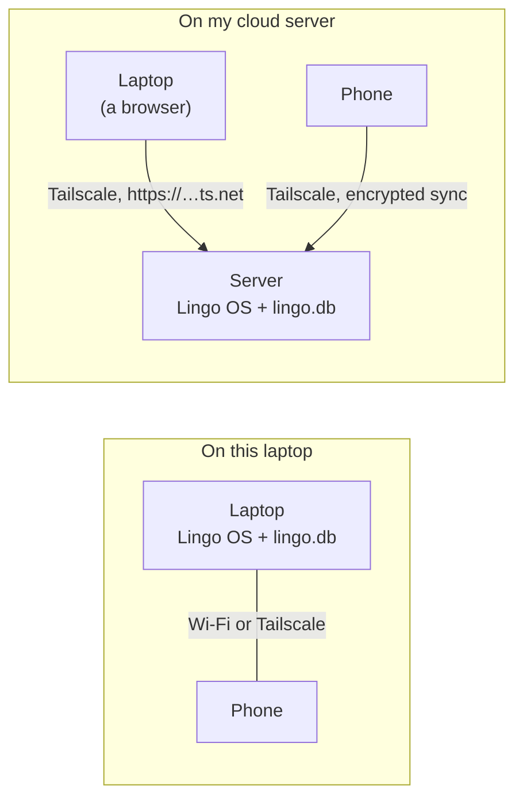

# Running Lingo OS on a free server

## Two ways to run

Lingo OS runs in one of two places. You choose in the app, under **Settings → Where Lingo OS runs**, and you can
switch back and forth:

| | **On this laptop** (how it starts) | **On my cloud server** |
|---|---|---|
| Where your data lives | the laptop (`data/`) | the server (`~/lingo-data`) |
| On the laptop you use | `npm run start`, at http://127.0.0.1:8787 | a browser, at `https://<server>.<tailnet>.ts.net` |
| The phone pairs and syncs with | the laptop: home Wi-Fi, or anywhere with Tailscale | the server, from anywhere, with Tailscale |
| Laptop and phone in step | when the phone reaches the laptop | always: there is one database, the server's |
| Laptop has to be on | yes, for the phone to get anything new | no |
| Background searches, weekly review | the laptop (`scripts/schedule-windows.ps1`) | the server (systemd timers) |
| Whisper transcription | available (Settings → Transcription) | leave it off on a small server |
| Updates | `git pull` | automatic, from GitHub (section 7) |



When the laptop is set to **On my cloud server**:

- its pages show *Lingo OS runs on your cloud server* with a link there (Settings stays reachable, to switch back);
- it doesn't listen for phones or pair them: the phone pairs with the server;
- its background searches stay off, and the Windows scheduled tasks (`update-content`, `evolve-profile`) skip their runs.

**Switching doesn't copy your data.** One script copies it each way: `deploy\push-data.ps1` (laptop → server,
section 6) and `deploy\pull-data.ps1` (server → laptop, section 8). Then pair the phone again with whichever one you
now use. Don't use both copies side by side: they are two separate databases that don't sync with each other.

## Checklist: from nothing to laptop and phone on the server

About an hour the first time. Each step links to its details.

1. [ ] **Oracle Cloud account**, with a home region close to you (section 2).
2. [ ] **Tailscale account** (section 3.1).
3. [ ] **An SSH key** on your PC (section 4).
4. [ ] **Create the VM** in the Oracle console, with your public key and a public IP (section 5, step 1).
5. [ ] **Sign in to the VM** with `ssh` and **run the setup script** (section 5, steps 2–3).
6. [ ] **Approve the server in Tailscale**: the sign-in link, then *enable Serve*; check MagicDNS and HTTPS are on, and turn off key expiry for the server (section 3.2).
7. [ ] **Tailscale on your PC**, signed in to the same account (section 3.3). Open the server's address and sign in with the access token.
8. [ ] **Set the laptop to the server** (Settings → Where Lingo OS runs → On my cloud server) and **copy your data** with `push-data.ps1` (section 6, steps 1–3).
9. [ ] **Tailscale on your phone**, signed in to the same account and connected (section 3.4).
10. [ ] **The Lingo OS app on your phone** ([PHONE.md](PHONE.md), "Install the app").
11. [ ] **Pair the phone with the server**: the server's Settings → Phone → *Pair a phone*; on the phone *Disconnect* (if it was paired before) and scan (section 6, step 4).
12. [ ] **Check**: change something on the phone (mark a word), reload the server's page on the PC, and see it there.

## 1. Which free server

| Option | What you get for free | Fits Lingo OS? |
|---|---|---|
| **Oracle Cloud "Always Free", Ampere A1 (recommended)** | Arm VM up to **2 CPUs and 12 GB RAM**, **200 GB** disk, 10 TB of traffic a month, no time limit | **Yes, comfortably.** Lingo OS needs about 1.5–2 GB of RAM with a few languages loaded, plus ~3–4 GB of disk with your data. |
| Oracle Cloud "Always Free", E2.1.Micro | AMD VM, 1/8 CPU, **1 GB RAM**, up to two | **As a start.** Works with 1–2 languages thanks to compressed swap (section 5, "A 1 GB VM"), slowly. No Whisper. Move to an A1 when you get one (section 9). |
| Google Cloud free tier, e2-micro | 1 shared CPU, **1 GB RAM**, 30 GB disk, in three US regions only | Like the Micro above. |
| Render, Koyeb, Railway, Hugging Face Spaces, Fly.io… | Free web apps that **sleep when idle and/or lose their disk** on restart (or no longer have a free tier) | **No.** Lingo OS keeps everything in a database file on disk and runs background jobs; a disk that resets would lose your progress. |
| A paid VPS (Hetzner, Netcup, DigitalOcean…) | 2 CPUs / 4 GB from a few euros a month | **Yes.** The setup script works on any Ubuntu 24.04 server, Arm or x86. Skip section 2. |

**Recommendation: Oracle Cloud Always Free, with a VM of 1 CPU and 6 GB RAM** (the "VM.Standard.A1.Flex" shape, Ubuntu 24.04).

Things to know about Oracle:

1. **The free allowance was halved in 2026**, from 4 CPUs / 24 GB to **2 CPUs / 12 GB**. A VM bigger than that is shut down, so stay within it. Check the current numbers on Oracle's [Always Free Resources](https://docs.oracle.com/en-us/iaas/Content/FreeTier/resourceref.htm) page.
2. **Oracle reclaims free VMs it considers idle.** A VM counts as idle if, over 7 days, CPU (95th percentile), network *and* memory all stay under 20%. A 6 GB VM keeps Lingo OS's loaded language models and dictionaries above 20% of its memory, which is why 6 GB beats 12 GB here. Upgrading the account to "Pay As You Go" also removes the reclaiming, and you still pay nothing as long as you stay within the free allowance. It needs a card on file, so read Oracle's terms first.
3. **Arm VMs are often "out of capacity"** in popular regions, and a free account can't use any region but its home region. Some regions, such as Mumbai, have a single availability domain. Trying each fault domain (*Advanced options* under Placement), a smaller size, or quiet hours can help. If nothing works, start on the E2.1.Micro and move later (section 9), or upgrade to Pay As You Go, which gets Arm VMs much more reliably.

Sources: [Oracle Always Free Resources](https://docs.oracle.com/en-us/iaas/Content/FreeTier/resourceref.htm), [InfoQ on the 2026 limits](https://infoq.com/news/2026/07/oracle-cloud-free-tier-limits/), [Linuxiac](https://linuxiac.com/?p=214114), [Google Cloud free features](https://docs.cloud.google.com/free).

**What runs where on a server:** the heavy work moves there: finding new videos, articles and podcasts, measuring their level, the language models, the weekly review and the AI explanations (your API keys move with the data and stay on the server). Manga OCR with mokuro wants a GPU, and Whisper transcription is very slow on a small CPU: for those, switch the laptop to *On this laptop* for a while (section 8), then push the data again.

## 2. An Oracle Cloud account

1. Sign up at [oracle.com/cloud/free](https://www.oracle.com/cloud/free/). It asks for a card to check you're a person; the Always Free resources cost nothing.
2. **Pick your home region carefully.** It's chosen at sign-up and can never be changed, and free VMs can only be created there. Choose one near you (latency to the phone matters a little), and if you have a choice between nearby regions, one with several availability domains tends to have more Arm capacity.
3. Sign in to the console at [cloud.oracle.com](https://cloud.oracle.com) with your *cloud account name*.

New accounts start with a 30-day free trial with credits. The Always Free shapes in this guide stay free after it ends; anything else stops.

## 3. Tailscale: the private network between your devices

**Why it's needed.** The server is on the internet, but Lingo OS on it holds your personal data and is not meant to be
public. [Tailscale](https://tailscale.com/) puts the server, your PC and your phone on one private, encrypted network
(WireGuard), wherever each of them is:

- the server opens **no port** for Lingo OS: it answers only your own devices, signed in to your Tailscale account;
- the server gets a stable name and a real **HTTPS** address, like `https://lingo-os.tail1234.ts.net`, with no domain
  or certificate to set up;
- the **phone reaches the server from anywhere**, over Wi-Fi or mobile data, as long as Tailscale is connected on it.

The free *Personal* plan is enough (it covers dozens of devices). Without Tailscale the server can't be reached by your
devices at all, as set up here. (The alternative, a public domain with a reverse proxy, is in section 11.)

### 3.1 An account

Sign up at [tailscale.com](https://tailscale.com/) with a Google, Microsoft, GitHub or Apple account. Use **the same
account on every device** below: devices only see each other inside one account (a *tailnet*).

### 3.2 The server

The setup script (section 5) installs Tailscale and starts it. It then shows two links in the terminal; open each in a
browser where you're signed in to Tailscale:

1. `https://login.tailscale.com/a/…`: **adds the server** to your tailnet. Approve it.
2. `https://login.tailscale.com/f/serve?node=…` (only the first time on your tailnet): **enables Serve**, which
   publishes the app at the server's HTTPS address to your devices only. Press *Enable*.

The script carries on by itself after each one. Then, once, in the [admin console](https://login.tailscale.com/admin):

- **DNS → MagicDNS** and **HTTPS Certificates**: both on (enabling Serve usually turns them on). Without them the
  `https://…ts.net` address doesn't work.
- **Machines → the server (`lingo-os`) → ⋯ → Disable key expiry.** Otherwise, after 180 days, the server drops off your
  tailnet until someone signs it in again over SSH (`sudo tailscale up`).

The server's address is its full name on the Machines page, also printed at the end of the setup and kept as
`LINGO_PUBLIC_URL` in `~/lingo-os/.env`.

### 3.3 Your PC

1. Install Tailscale for Windows from [tailscale.com/download/windows](https://tailscale.com/download/windows).
2. Click its icon in the taskbar's notification area → *Log in*, and sign in with the same account.
3. Check: `tailscale status` in PowerShell lists the server; and the server's address opens in a browser.

### 3.4 Your phone

1. Install **Tailscale** from the Play Store, open it, sign in with the same account.
2. Turn it on, and allow the VPN connection Android asks about (it's how Tailscale works; only traffic to your own
   devices goes through it).
3. Optional, recommended: Android Settings → Network → VPN → Tailscale → **Always-on VPN**, so the phone stays
   connected after a restart.
4. Check: open the server's address in the phone's browser; the Lingo OS sign-in page appears.

When Tailscale is off on the phone, the app keeps working with what's saved for offline and syncs once it's back on.

## 4. An SSH key (once, on your PC)

You manage the server over SSH (a secure terminal connection) and sign in with an **SSH key** rather than a password.
A key comes in two halves:

- the **private key** stays on your PC and is never shared: anyone who has it can sign in to your server;
- the **public key** is given to the server when you create it (section 5). It's safe to paste anywhere.

Windows 10 and 11 already include OpenSSH. In PowerShell:

```powershell
ssh-keygen -t ed25519 -f "$env:USERPROFILE\.ssh\lingo_oracle" -C "lingo-os-server"
```

Press Enter twice for no passphrase, or type one to protect the key (then you type it whenever you connect). This
writes `~\.ssh\lingo_oracle` (private) and `~\.ssh\lingo_oracle.pub` (public). Show the public key, to copy it:

```powershell
Get-Content "$env:USERPROFILE\.ssh\lingo_oracle.pub"
```

It's one line starting with `ssh-ed25519`. Once the server exists (section 5, step 1), give it a short name: add this to
`~\.ssh\config` (create the file if it isn't there; no file extension), with the server's public IP:

```
Host lingo-oracle
  HostName <the server's public IP>
  User ubuntu
  IdentityFile ~/.ssh/lingo_oracle
  IdentitiesOnly yes
```

Then `ssh lingo-oracle` connects, and the scripts in this guide take `-Server lingo-oracle`.

**Back up the private key** (a password manager, an encrypted drive). Without it you can't sign in to the server.
Never paste the private key into a chat, an issue or the server's settings.

## 5. Set up the server (about 30 minutes)

1. **Create the VM.** In the Oracle Cloud console: *Compute → Instances → Create instance*.
   - **Name:** `lingo-os` (it also becomes the server's Tailscale name).
   - **Image:** Ubuntu 24.04. For the 1 GB Micro, **Ubuntu 24.04 Minimal** saves memory.
   - **Shape:** VM.Standard.A1.Flex, 1 OCPU, 6 GB memory (or VM.Standard.E2.1.Micro, see section 1).
   - **Networking:** create a new virtual cloud network with a public subnet, and turn on **Automatically assign public IPv4 address**. (If the switch is greyed out while the network is still to be created, create the instance anyway and add a public IP afterwards under *Networking → Attached VNICs → IPv4 addresses*.) The public IP is only used for SSH.
   - **SSH keys:** *Paste public key*, and paste the line from section 4.
   - **Boot volume:** the default (about 47 GB) is plenty. Don't open any ports.

   When the VM shows *Running*, its **Public IP address** is on its details page: put it in `~\.ssh\config` (section 4).
2. **Sign in to the VM:** `ssh lingo-oracle`. The first time, answer *yes* to trust the server's fingerprint.
3. **Run the setup script** on the VM:

   ```bash
   curl -fsSL https://raw.githubusercontent.com/proy9714/lingo-os/main/deploy/setup-server.sh -o setup-server.sh
   bash setup-server.sh
   ```

   It installs what Lingo OS needs (ffmpeg, Node, uv, Tailscale), builds the app (several minutes, longer on a 1 GB VM), and sets it to start with the machine. It schedules the daily content search and the weekly review (systemd timers, the server's equivalent of `scripts/schedule-windows.ps1`), and **automatic updates from GitHub** (section 7). On a VM with under 3 GB of RAM it first adds compressed swap (below). Near the end it shows the **two Tailscale links** of section 3.2: open them. Finally it prints:
   - **the address**, like `https://lingo-os.tail1234.ts.net`, and
   - **an access token**, which you type once per browser. It's also kept in `~/lingo-os/.env` (`ssh lingo-oracle "grep LINGO_ACCESS_TOKEN ~/lingo-os/.env"` shows it).
4. **On your PC** (Tailscale on, section 3.3): open the address, enter the token. The server has no data yet: that's section 6.

### A 1 GB VM

On a VM with less than 3 GB of RAM the setup script adds three safeguards, so it slows down instead of running out of memory:

- **zram**: compressed swap inside RAM (half its size). Memory that isn't in use is compressed about 2–3× and kept in RAM; it's used first because it's fast.
- **a 4 GB swap file** on disk: the slower backstop once zram is full.
- **earlyoom**: if memory and swap are both nearly gone, it stops the biggest process (preferring a build) before the machine freezes; systemd restarts Lingo OS within seconds.

Each language you use keeps its language model and dictionary loaded, so keep to one or two languages on 1 GB, and leave Whisper off (Settings → Transcription, no model chosen).

## 6. Move to the server: data, laptop, phone

On the laptop, in the Lingo OS folder:

1. **Set the laptop to the server.** With Lingo OS running on the laptop as usual, open Settings → **Where Lingo OS runs** → **On my cloud server**, enter the server's address, press *Check the address* (it should say Lingo OS answers there), then *Save*. The laptop's pages now point to the server, and the laptop stops syncing with the phone.
2. **Stop Lingo OS on the laptop** (close `npm run start` / `npm run dev`), so its database isn't written while it's copied.
3. **Copy the data across**, in PowerShell:
   ```powershell
   .\deploy\push-data.ps1 -Server lingo-oracle
   ```
   It packs your data folder (database, dictionaries, library, language models), copies it, and restarts the app on the server. The laptop's copy is left as it was, so it doubles as a backup. Anything already on the server is kept in `~/lingo-data-before-push`. Reload the server's page on the PC: your languages and progress are there.
4. **Pair the phone with the server.** On the PC, in the **server's** page: Settings → Phone → tick *Let phones sync with this server* → *Pair a phone*. On the phone (Tailscale connected): open the sync screen (tap the status badge, or go to `/connect`), press *Disconnect* if it was paired with the laptop, then scan the code. The code carries the server's HTTPS address, so the phone reaches it from anywhere.

From now on, use the server's address on the PC (bookmark it). You don't need to start Lingo OS on the laptop any more; if you do, it just points you to the server.

Alternatively to step 3, *Settings → Download a backup* on the laptop and *Restore from a backup…* on the server move your progress, but not dictionaries or media files.

## 7. Updates: the server follows GitHub

The server checks GitHub every 15 minutes (`lingo-update.timer`, running `deploy/update-server.sh`) and updates itself.
What it follows is `LINGO_UPDATE_CHANNEL` in `~/lingo-os/.env`:

| Value | Updates on |
|---|---|
| `main` (default) | every push to the `main` branch |
| `release` | published releases only (the newest `vX.Y.Z` tag, see [RELEASING.md](RELEASING.md)) |
| `off` | never by itself |

An update pulls the new code, reinstalls Python or Node packages only if they changed, rebuilds the web app only if the
frontend changed, applies database migrations and restarts the app. If any step fails, or the new version doesn't
answer, it goes back to the version that was running. Your data and `.env` are never touched. Browsers pick up the new
version on their next page load. The phone app is separate: it updates from GitHub releases (Obtainium, [PHONE.md](PHONE.md)).

- **See what it did:** `journalctl -u lingo-update -n 50`
- **Update now:** `sudo systemctl start lingo-update` (or `bash ~/lingo-os/deploy/update-server.sh`)
- **Change the channel:** edit `LINGO_UPDATE_CHANNEL` in `~/lingo-os/.env`; the next check uses it.

Going back to an older version doesn't undo a database migration, so new migrations should keep working with the
previous code for one release.

## 8. Switching back to the laptop

1. Stop Lingo OS on the laptop if it's running.
2. Copy the server's data back, in PowerShell:
   ```powershell
   .\deploy\pull-data.ps1 -Server lingo-oracle
   ```
   The laptop's old data folder is moved aside to `data-before-pull`, never deleted.
3. Start Lingo OS on the laptop (`npm run start`). The copied data still says *On my cloud server* (it was saved on the laptop before the push), so open Settings → **Where Lingo OS runs** → **On this laptop** → *Save*.
4. Settings → **Phone**: tick *Let a phone sync over this Wi-Fi* → *Pair a phone*; on the phone *Disconnect*, then scan.

The server keeps its copy. Stop it (`ssh lingo-oracle "sudo systemctl stop lingo"`) or leave it as a backup, but don't use both.

## 9. Day to day

- **Logs:** `journalctl -u lingo -f`. **Health:** `uv run --project backend lingo doctor` shows a *server access* line.
- **Backups:** `uv run --project backend lingo data export` writes one file with all your progress. Copy it somewhere off the server now and then. Oracle's free tier also includes five volume backups.
- **Sizing:** idle with three languages loaded uses about 1.5 GB of RAM, plus about 1 GB more while Whisper transcribes. The `small` Whisper model on one Arm core takes roughly real time (a 20-minute episode ≈ 20 minutes), quietly in the background.
- **Moving to a bigger VM** (from the 1 GB Micro to an A1, say; Oracle can't change a VM between AMD and Arm): create the new VM with a different name, run the setup script on it (section 5), and add it to `~\.ssh\config` as, say, `lingo-new`. Copy the data across: `ssh lingo-oracle "sudo systemctl stop lingo; tar -czf - -C ~/lingo-data ." | ssh lingo-new "sudo systemctl stop lingo; tar -xzf - -C ~/lingo-data; sudo systemctl start lingo"`. Then put the new address in Settings → Where Lingo OS runs on the laptop, pair the phone again, and delete the old VM (and remove it from Tailscale's Machines page). Both VMs fit in the free allowance at once.

## 10. Settings reference

All of these go in `~/lingo-os/.env` on the server. On a laptop leave them out: nothing changes there.

| Setting | What it does |
|---|---|
| `LINGO_DATA_DIR` | Where the database and files live (`~/lingo-data`). |
| `LINGO_HOST`, `LINGO_PORT` | What the app listens on. Keep `127.0.0.1:8787` behind `tailscale serve`. |
| `LINGO_PUBLIC_URL` | The address your devices use. Phones are given it when they pair, and sync through the main port (`/sync/...`) instead of the Wi-Fi listener on 8788. Setting it also marks this Lingo OS as a server: Settings → Where Lingo OS runs says so and can't be switched. |
| `LINGO_ACCESS_TOKEN` | When set, a browser must sign in once at `/login` (scripts can send `Authorization: Bearer …`). Phones don't need it: they prove themselves with their pairing key on every request. |
| `LINGO_SYNC_ON_MAIN` | Force phone sync on or off the main port (default: on when a public URL is set). |
| `LINGO_UPDATE_CHANNEL` | `main`, `release` or `off`: what the server updates itself to (section 7). |
| `LINGO_YTDLP_COOKIES`, `LINGO_YTDLP_PROXY` | YouTube often refuses requests from cloud servers ("sign in to confirm you're not a bot"). Point the first at a `cookies.txt` exported from a browser signed in to YouTube; or send YouTube requests through another connection with the second. Articles, podcasts and everything else are unaffected. |

On the laptop, *Where Lingo OS runs* is saved in its own database, not in `.env`.

## 11. Troubleshooting

- **The server's address doesn't open on the PC or phone:** is Tailscale connected on that device, signed in to the same account (`tailscale status` on the PC lists the server)? Are MagicDNS and HTTPS Certificates on (section 3.2)?
- **The phone says it can't reach your Lingo OS:** as above, on the phone; then open the server's address in the phone's browser. The app keeps working with what's in Downloads meanwhile.
- **The laptop's pages say "Lingo OS runs on your cloud server" but you want the laptop:** section 8.
- **`ssh` says "Permission denied (publickey)":** the key you use isn't the one the VM was created with. Check `IdentityFile` in `~\.ssh\config` and that the `.pub` you pasted belongs to it.
- **The server dropped off Tailscale after months:** its key expired. `ssh lingo-oracle "sudo tailscale up"`, open the link, then disable key expiry (section 3.2).
- **New YouTube videos stop appearing:** see `LINGO_YTDLP_COOKIES` above. Articles and podcasts keep coming.
- **An update didn't arrive:** `journalctl -u lingo-update -n 50` says why (for example, files edited by hand on the server).
- **The VM was stopped by Oracle:** see the idle rule in section 1. Start it again in the console; your data is on its disk.
- **"Out of capacity" when creating the VM:** section 1, point 3.
- **Exposing the server without Tailscale** (a domain with a reverse proxy such as Caddy) works too, but then `LINGO_ACCESS_TOKEN` is a must, you open ports 80/443 to the internet, and you should keep your server updated.
