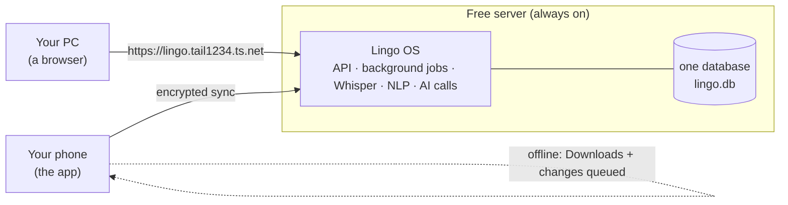

# Running Lingo OS on a free server

So far Lingo OS has lived on your laptop, and your phone reached it over your Wi-Fi (or Tailscale). That means the laptop has to stay on for the phone to get anything new. This guide moves Lingo OS to a small server on the internet that is always on and costs nothing. After that:

- **Your phone** talks to the server instead of the laptop, from anywhere.
- **Your PC** opens Lingo OS in a browser, from the server. The laptop doesn't need to be on, and it no longer does the heavy work.
- **Both always show the same thing**, because there is now one database: the server's.

## 1. Which free server

| Option | What you get for free | Fits Lingo OS? |
|---|---|---|
| **Oracle Cloud "Always Free", Ampere A1 (recommended)** | Arm VM up to **2 CPUs and 12 GB RAM**, **200 GB** disk, 10 TB of traffic a month, no time limit | **Yes, comfortably.** Lingo OS needs about 1.5–2 GB of RAM with a few languages loaded, plus ~3–4 GB of disk with your data. |
| Google Cloud free tier, e2-micro | 1 shared CPU, **1 GB RAM**, 30 GB disk, in three US regions only | Only just: 1 GB doesn't hold the dictionaries and the language models. Usable with a swap file and one or two languages, slowly. A fallback. |
| Render, Koyeb, Railway, Hugging Face Spaces, Fly.io… | Free web apps that **sleep when idle and/or lose their disk** on restart (or no longer have a free tier) | **No.** Lingo OS keeps everything in a database file on disk and runs background jobs; a disk that resets would lose your progress. |

**Recommendation: Oracle Cloud Always Free, with a VM of 1 CPU and 6 GB RAM** (the "VM.Standard.A1.Flex" shape, Ubuntu 24.04).

Three things to know about Oracle:

1. **The free allowance was halved in 2026**, from 4 CPUs / 24 GB to **2 CPUs / 12 GB**. A VM bigger than that is shut down, so stay within it. Check the current numbers on Oracle's [Always Free Resources](https://docs.oracle.com/en-us/iaas/Content/FreeTier/resourceref.htm) page.
2. **Oracle reclaims free VMs it considers idle.** A VM counts as idle if, over 7 days, CPU (95th percentile), network *and* memory all stay under 20%. A 6 GB VM keeps Lingo OS's loaded language models and dictionaries above 20% of its memory, which is why 6 GB beats 12 GB here. Upgrading the account to "Pay As You Go" also removes the reclaiming, and you still pay nothing as long as you stay within the free allowance. It needs a card on file, so read Oracle's terms first.
3. **Arm VMs are sometimes "out of capacity"** in popular regions. Pick your home region carefully when you sign up (it can't be changed later), and if creating the VM fails, try again later or in another availability domain.

Sources: [Oracle Always Free Resources](https://docs.oracle.com/en-us/iaas/Content/FreeTier/resourceref.htm), [InfoQ on the 2026 limits](https://infoq.com/news/2026/07/oracle-cloud-free-tier-limits/), [Linuxiac](https://linuxiac.com/?p=214114), [Google Cloud free features](https://docs.cloud.google.com/free).

## 2. The picture after the move



- **One place for your data.** The PC and the phone don't sync with each other; both use the server, so there's nothing to reconcile. A word you mark on the phone is marked when you open the PC, and the other way round.
- **Offline still works.** Anything you saved in **Downloads** (texts, manga, podcast episodes, transcripts) works with no connection, on the phone and in the PC's browser. On the phone, everything you do offline (lookups, word statuses, time, reading progress) waits in a queue and is sent to the server the moment it's back in reach. Each change is applied exactly once, and if a word was changed in two places, the later change wins.
- **The heavy work moves to the server:** finding new videos, articles and podcasts, measuring their level, Whisper transcriptions, the language models (spaCy, Japanese and Chinese tokenisers), the weekly review and the AI explanations (your API keys move with the data and stay on the server). The PC only runs a browser.
- **What may stay on the laptop:** manga OCR with mokuro wants a GPU and is very slow on a small CPU. Process new manga volumes on the laptop, then move them over with the data (step 4), or skip manga.
- **Private by default.** The server only answers on its own machine; [Tailscale](https://tailscale.com/) (free for personal use) gives your PC and phone, and only them, an HTTPS address for it. Nothing is open to the internet.

> **Don't run the laptop copy and the server copy side by side.** They are two separate databases that don't sync with each other. After moving, stop the laptop copy and use the server in a browser.

## 3. Set up the server (about 30 minutes)

1. **Create the VM.** In the Oracle Cloud console: *Compute → Instances → Create instance*. Image: **Ubuntu 24.04** (aarch64). Shape: **VM.Standard.A1.Flex, 1 OCPU, 6 GB memory**. Boot volume: 50–100 GB. Add your SSH public key. You don't need to open any ports.
2. **Sign in to the VM** with SSH (the console shows its public IP): `ssh ubuntu@<public-ip>`
3. **Run the setup script:**

   ```bash
   curl -fsSL https://raw.githubusercontent.com/proy9714/lingo-os/main/deploy/setup-server.sh -o setup-server.sh
   bash setup-server.sh
   ```

   It installs what Lingo OS needs (ffmpeg, Node, uv, Tailscale), builds the app, and sets it to start with the machine. It also schedules the daily content search and the weekly review (systemd timers, the server's equivalent of `scripts/schedule-windows.ps1`). It asks you to sign in to Tailscale, and finally prints:
   - **the address**, like `https://lingo.tail1234.ts.net`, and
   - **an access token**, which you type once per browser. It's also kept in `~/lingo-os/.env`.

   Tailscale needs **HTTPS certificates** turned on once, for `tailscale serve`: in the Tailscale admin console go to *DNS → enable MagicDNS and HTTPS Certificates*.
4. **Install Tailscale on your PC and your phone** and sign in with the same account.
5. **Open the address on your PC**, enter the token, and you're in.

## 4. Bring your existing data over

On the laptop, in the Lingo OS folder, in PowerShell:

1. Stop Lingo OS on the laptop (close `npm run start` / `npm run dev`).
2. Copy the data across:
   ```powershell
   .\deploy\push-data.ps1 -Server ubuntu@lingo
   ```
   Use the server's Tailscale name (as in its address) and its user. The script packs your data folder (database, dictionaries, library, language models), copies it, and restarts the app there. Your laptop's copy is left as it was, so it doubles as a backup.
3. **Pair your phone again**, this time with the server. On the PC go to *Settings → Phone → Pair a phone*. On the phone, open the sync screen, press *Disconnect*, then scan the new code. The phone gets the server's HTTPS address in the code.

Alternatively, use *Settings → Download a backup* on the laptop and *Restore from a backup…* on the server. That moves your progress, but not dictionaries or media files.

## 5. Day to day

- **Updates:** `cd ~/lingo-os && git pull && uv sync --project backend && npm run build && sudo systemctl restart lingo` (on the server, over SSH).
- **Logs:** `journalctl -u lingo -f`. **Health:** `uv run --project backend lingo doctor` shows a *server access* line.
- **Backups:** `uv run --project backend lingo data export` writes one file with all your progress. Copy it somewhere off the server now and then. Oracle's free tier also includes five volume backups.
- **Sizing:** idle with three languages loaded uses about 1.5 GB of RAM, plus about 1 GB more while Whisper transcribes. The `small` Whisper model on one Arm core takes roughly real time (a 20-minute episode ≈ 20 minutes), quietly in the background.

## 6. Settings reference

All of these go in `~/lingo-os/.env` on the server. On a laptop leave them out: nothing changes there.

| Setting | What it does |
|---|---|
| `LINGO_DATA_DIR` | Where the database and files live (`~/lingo-data`). |
| `LINGO_HOST`, `LINGO_PORT` | What the app listens on. Keep `127.0.0.1:8787` behind `tailscale serve`. |
| `LINGO_PUBLIC_URL` | The address your devices use. Phones are given it when they pair, and sync through the main port (`/sync/...`) instead of the Wi-Fi listener on 8788. |
| `LINGO_ACCESS_TOKEN` | When set, a browser must sign in once at `/login` (scripts can send `Authorization: Bearer …`). Phones don't need it: they prove themselves with their pairing key on every request. |
| `LINGO_SYNC_ON_MAIN` | Force phone sync on or off the main port (default: on when a public URL is set). |
| `LINGO_YTDLP_COOKIES`, `LINGO_YTDLP_PROXY` | YouTube often refuses requests from cloud servers ("sign in to confirm you're not a bot"). Point the first at a `cookies.txt` exported from a browser signed in to YouTube; or send YouTube requests through another connection with the second. Articles, podcasts and everything else are unaffected. |

## 7. Troubleshooting

- **The phone says it can't reach your Lingo OS:** is Tailscale on and connected on the phone? Open the server's address in the phone's browser to check. The app also says so at once now, and keeps working with what's in Downloads.
- **New YouTube videos stop appearing:** see `LINGO_YTDLP_COOKIES` above. Articles and podcasts keep coming.
- **The VM was stopped by Oracle:** see the idle rule in section 1. Start it again in the console; your data is on its disk.
- **"Out of capacity" when creating the VM:** try again later or in another availability domain.
- **Exposing the server without Tailscale** (a domain with a reverse proxy such as Caddy) works too, but then `LINGO_ACCESS_TOKEN` is a must, and you should keep your server updated.
