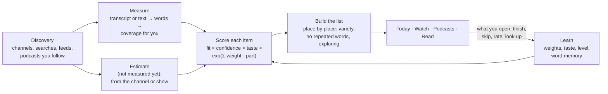
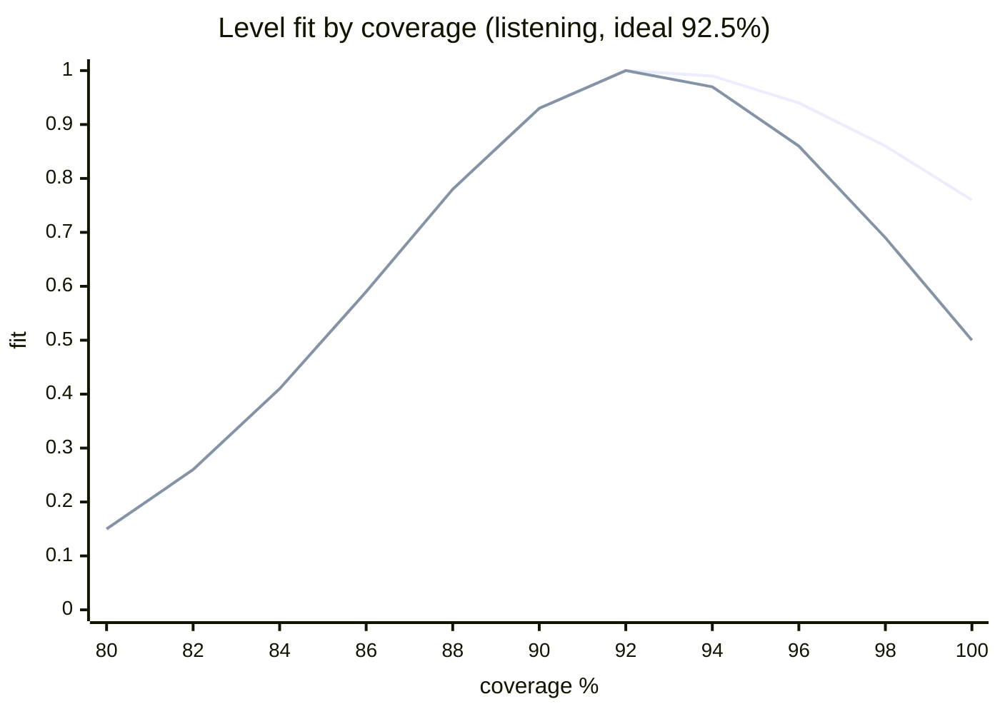
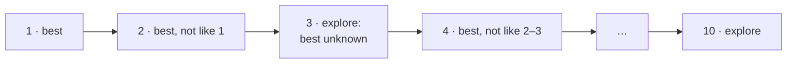

# How Lingo OS picks what you watch, read and listen to next

The recommender is the heart of Lingo OS. Its job is to answer one question well:

> **Of everything you could spend your next 20 minutes on, which will teach you the most that you'll actually understand and enjoy?**

This page explains how it answers that, in plain words, with worked examples. The code is in `backend/app/services/recommend.py` (assembling the lists), `ranker.py` (the scoring and the list building), `taste.py` (what you enjoy), `calibration.py` (your level), and `engine/memory.py` (how well your words are sticking).

We call the approach **Comprehensible Input Value**: for each item, *how much comprehensible learning it gives you per minute, times how likely you are to engage with it*. Then the list is built place by place, not just sorted.

## The whole pipeline

Everything you do feeds back in: what you open, how much of it you finish, what you scroll past, how hard you rate things, and which words you look up.

## 1. Can you follow it? (level fit)

Every measured item has a **coverage**: the share of its running words you probably know. It's computed from each word's frequency, your vocabulary profile, the statuses you've set, the memory model, and how often you've heard the word in things you actually watched (counting the share you got through, not whole items).

Research on comprehensible input says you understand and learn best somewhere around **90–98% coverage**. Below that it's a struggle; well above it there's little left to learn. Your personal ideal is learned from your **difficulty ratings** ("very easy" … "very hard"), separately for listening and reading, because the same coverage feels harder by ear. A weekly review nudges it too.

The **fit** is 1.0 at your ideal and falls off on both sides, but **not evenly**. Something a bit easier than ideal is still pleasant and useful. Something a bit harder is tiring, and you learn less, because there are too many unknowns to work out from context. So the easy side falls off 1.6× more slowly:

Bands, from easy to hard: **too easy · comfortable · just right (i+1) · stretch · too hard**. When there's little at your level yet (a new language), the lists are filled with the closest finds, so they're never empty.

**Estimated items.** A video from a channel whose other videos have been measured gets the channel's average (blended with your ideal). A learner channel's label ("A2", "intermediate") shifts it. A podcast episode gets the show's measured average. Estimated items score a little lower (×0.6 to ×0.92, by how much the estimate rests on), and the best-placed ones are measured in the background first.

## 2. What it's worth to you: the parts

On top of the fit, each item gets parts, each 0 when neutral. Together they multiply the score by exp(Σ weight × part).

| Part | What it measures | Range | Starting weight |
|---|---|---|---|
| **learn** | learnable new words per minute, compared with the other suggestions | −0.5 … +0.5 | 0.55 |
| **reinforce** | words you're learning that it brings back, as they start to fade | 0 … 1 | 0.5 |
| **series** | it's the next episode or volume of something you're following | 0 or 1 | 0.45 |
| **recent** | news and podcast episodes from the last weeks | 0 … 1 | 0.3 |
| **speed** | speech much faster than the videos you finish | −0.5 … 0 | 1.0 |
| **skipped** | a card you've scrolled past several times without opening (fades over 3 weeks) | −1 … 0 | 1.0 |

### learn: new words you're ready for, per minute

Not every unknown word is worth the same. For each word in the item that you don't know yet:

- **Are you ready for it?** Words up to 2× beyond your vocabulary frontier (the rank where you know half the words) are prime. Words up to 8× still count. Very rare words count little: you may never meet them again.
- **Does it repeat in the item?** A word heard once may slip by. Three times, and you'll likely pick it up from context (×0.35 for once, ×0.7 for twice, ×1.0 for three or more).
- **Divided by the minutes it takes you.** That's the video's length, or for texts your own reading pace, measured from what you've read.

Each item's value is then compared with the middle (median) of all suggestions: twice as many learnable words per minute gives +0.5, half gives −0.5.

### reinforce: words that are starting to fade

For every word you're learning (or have as familiar) that the item contains, the memory model ([WORD_PROMOTION.md](WORD_PROMOTION.md)) knows how likely you are to still recognise it. The item gets credit for **how much those words have faded** (1 − recall, summed, saturating after about 6 words). This is how saved words come back without flashcards: through the next good video that happens to contain them, right when meeting them again helps most.

## 3. Will you enjoy it? (taste)

Learned from what you do, with no ratings needed:

- **Channels, sites and shows** you finish, come back to or dismiss. Each has a belief (a Beta distribution) about how likely you are to enjoy its next item. A channel you love scores high; one you've given up on, low. One you've never tried could be anything, so it's explored (section 5).
- **Lengths** you tend to finish (under 6 minutes, 6–12 minutes, and so on).
- **Topics**: the content words of what you enjoyed, compared with each candidate.

Together they multiply the score by ×0.45 … ×2.2. Signals fade with a half-life of 120 days, so your taste can change.

## 4. The score, and a worked example

> **score = fit × freshness × confidence × taste × exp(Σ weight × part)**

*Freshness* is ×1.25 for something you started and haven't finished. *Confidence* is 1 for measured items.

Three videos, your listening ideal is 92.5%:

| | A: a channel you like | B: very easy, a favourite | C: harder, dense with new words |
|---|---|---|---|
| coverage | 93% | 97.5% | 86% |
| fit | 1.00 | 0.89 | 0.59 |
| taste | ×1.20 | ×1.40 | ×1.00 |
| learn (vs median 1.2 words/min) | 1.8/min → +0.29 → ×1.17 | 0.6/min → −0.5 → ×0.76 | 3.0/min → +0.5 → ×1.32 |
| reinforce | 3 faded words (Σ 2.0) → 0.57 → ×1.33 | none | none |
| **score** | **1.87** | **0.94** | **0.78** |

**A** wins: right at your level, from a channel you like, teaching useful words, and bringing back three words you were starting to forget. **B** is enjoyable but teaches little. **C** teaches a lot, but you'd struggle. If you rate C "comfortable" anyway, your ideal moves down, and next time C-like items score higher.

Every suggestion carries this breakdown. Press **Why this?** under Today's top pick to see it, in words.

## 5. Building the list, place by place

Sorting by score would give you five videos from the same channel about the same topic. Instead the list is built **one place at a time**. Each place goes to the item with the best score after penalties for:

- **looking like the last few placed**: same channel or show, similar topic, same length, same kind;
- **bringing back words the list already brings back**: if A already reinforces *Brücke*, *Fenster* and *Spiegel*, a second item reinforcing the same three is worth less right after it. Spreading them over different items is better spacing.

**Exploring.** Every seventh place, starting with the third, goes to the most promising item the model is **unsure** about: one whose level is only estimated, or from a channel or show you've never spent time on. That's how it keeps discovering what you like, and how estimated finds get a chance to be measured. These picks say *"something new to try"*.

**Today** takes the same list with your remaining daily minutes in mind: items that fit the time left get ×1.15, and ones more than twice as long ×0.8. The list is then rebuilt, so it keeps its variety and its exploring places. It also mixes kinds (at most 4 of one kind, 2 per channel) and includes one stretch and one comfortable pick when there are some.

## 6. It learns how much each part matters to you

The starting weights in section 2 are educated guesses. Once a day the app checks them against what you actually do: of the cards it showed you, which did you open? It fits a **logistic regression** (opened or not, from each card's parts) with a **prior** on the starting weights, so a handful of clicks only nudges them, while hundreds of clicks can move them a long way. Each weight stays between ×0.25 and ×2.5 of its starting value.

Example: if you keep opening the items that bring back your learning words and ignore the "dense with new words" ones, the reinforce weight goes up and learn goes down, and your lists follow.

Skipping is the outcome here, not a feature, so its weight isn't fitted. Nothing leaves your machine: the fit runs on your laptop or server, in `ranker.fit_weights`.

## 7. Podcasts

Episodes of the shows you follow are suggested on the **Podcasts** tab by the same scoring. Two parts matter especially here: **series** (the next episode of a show you're working through) and **recent** (new this week). An episode with a publisher transcript is measured at once. Others are estimated from the show's measured episodes until Whisper transcribes the most promising ones, a few a day.

## 8. What the recommender never does

- **No flashcards, no review queue, no "due" lists.** Words come back only inside real content.
- **No exact levels.** Coverage and level estimates are shown as approximations (≈), and levels elsewhere as ranges with a confidence.
- **No sending your data out.** All scoring, taste and fitting runs on your own laptop or server.

## Where to look in the code

| Piece | File |
|---|---|
| candidates, Today, feeds, reasons, breakdown, learned weights trigger | `backend/app/services/recommend.py` |
| parts, list building, exploring, weight fitting | `backend/app/services/ranker.py` |
| taste (channels, lengths, topics, Thompson sampling) | `backend/app/services/taste.py` |
| your ideal coverage, bands, the lopsided fit | `backend/app/services/calibration.py` |
| coverage of an item for you | `backend/app/services/content.py` (`score_item`) |
| estimated levels (channels / shows) | `backend/app/services/catalog.py`, `backend/app/services/podcasts.py` |
| word memory | `backend/app/engine/memory.py` |
| tests (incl. a 1,500-item speed check) | `backend/tests/test_ranker.py`, `test_recommendation.py` |
