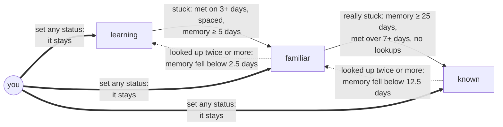
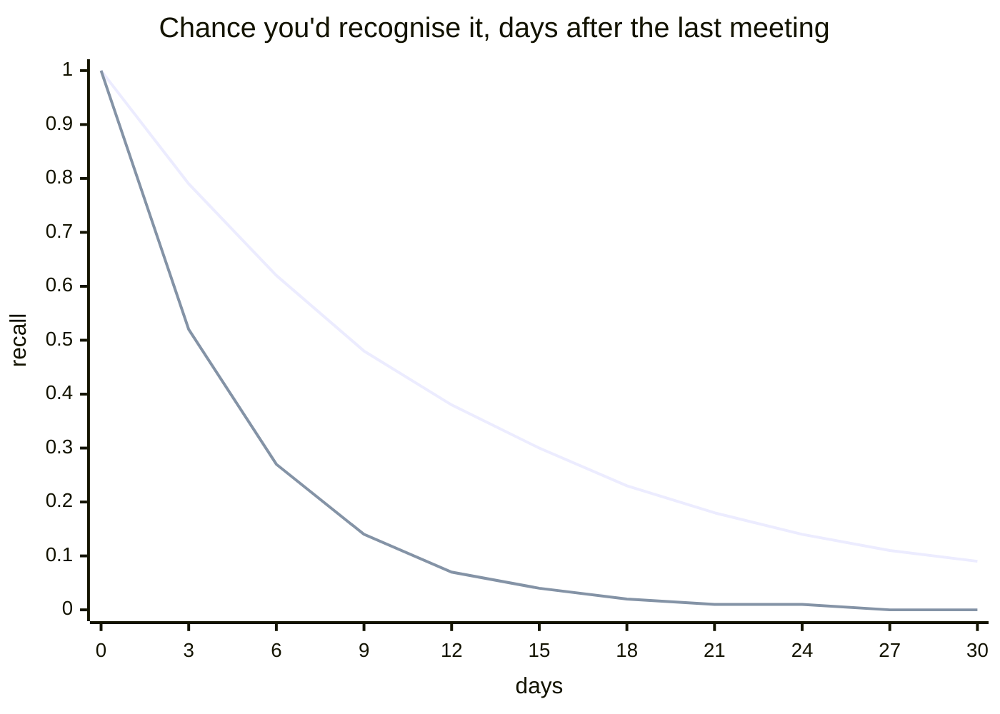
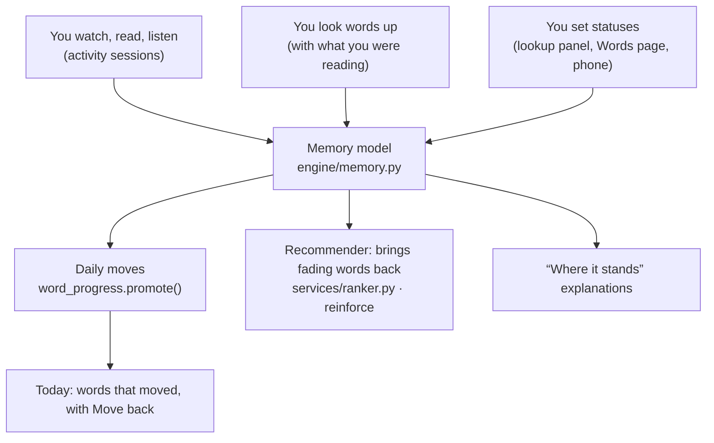

# How words move from learning to familiar to known

Lingo OS has no flashcards. Words you're learning come back through what you watch, read and listen to, and the app keeps track of how well each one is sticking. When a word has clearly stuck, it moves up a step by itself. When you keep looking a word up, it moves back a step. It learns how quickly words stick **for you**, and anything you set yourself stays as you set it.

This page explains how that works, in plain words, with real numbers from the code (`backend/app/engine/memory.py`, `backend/app/services/word_progress.py`).

## The idea in one picture



## 1. Every word has a "memory strength"

For each word you're learning (or have as familiar or known) the app keeps one number, its **stability**: roughly how many days you'd still recognise the word without meeting it again.

From it comes how likely you are to recognise the word **today**:

> recall = 2 ^ (− days since you last met it ÷ stability)

So right after meeting a word, recall is 100%. After *stability* days it's 50%, and after twice that, 25%. With a stability of 7 days:

| Days since you met it | 0 | 1 | 3 | 7 | 14 | 30 |
|---|---|---|---|---|---|---|
| Chance you'd recognise it | 100% | 91% | 74% | 50% | 25% | 5% |

The app never shows you these numbers as a schedule. There are no review dates and no due lists. They only decide which words have stuck, and the recommender uses them to bring fading words back through new videos and articles (see [RECOMMENDATION.md](RECOMMENDATION.md)).

## 2. What makes a word stronger

**Meeting it in something you actually watched, read or listened to.** Not the whole item: the share you got through. Ten minutes of a 40-minute video counts as a quarter of its words. Sessions under a minute don't count, and neither do whole books or manga volumes yet, because the app knows the words of the whole volume but not of the pages you read.

For each **day** you met the word without looking it up, its stability is multiplied by

> 1 + g × w × (1 + b × (1 − recall)) ÷ (1 + difficulty)

where:

- **w** is how much you met it that day, saturating: w = 1 − e^(−meetings ÷ 3). The first meetings in a day count most; the tenth adds almost nothing.
- **recall** is how likely you were to recognise it just before. Meeting a word **just as it was fading** strengthens it most: this is the *spacing effect*, the most reliable finding in memory research. Meeting it again the next morning helps only a little.
- **difficulty** is higher for rare words (far beyond your vocabulary frontier) and for words you keep looking up.
- **g** (growth, default 1.0) and **b** (spacing bonus, default 1.5) are how strongly this works. The app fits **g** to you (section 5).

**Looking a word up** means you didn't recognise it: stability × 0.45 (the *lapse*, also fitted to you), and the word gets a little harder.

### Example: spaced beats massed

Two words, both just marked *learning* (stability 1 day), each met in a 10-minute video, twice per video:

| | Day −12 | Day −7 | Day −2 | Stability now | Chance you'd recognise it today |
|---|---|---|---|---|---|
| **Brücke**: met on three different days | 1 → 2.2 | → 4.6 | → **8.6 days** | 8.6 days | 85% |
| **Mauer**: met three times on one day | — | — | 1 → **3.2 days** | 3.2 days | 65% |

The same three meetings make Brücke almost three times stronger, because they were spread out. Brücke has stuck: it moves to *familiar*. Mauer stays *learning* until you meet it again on other days.



A rare word met on the same spaced days grows more slowly (difficulty 0.5): it reaches 5.2 days, just enough for *familiar*.

## 3. When a word moves

The rules have a gap between moving up and moving down (hysteresis), so a word never flickers back and forth:

| Move | When |
|---|---|
| learning → **familiar** | stability ≥ 5 days, met on 3 or more different days, recall today ≥ 50% (not a word last seen months ago), no lookup in the last 2 days |
| familiar → **known** | stability ≥ 25 days, met on 3 or more days spread over at least a week, no lookup since it became familiar |
| known → familiar | looked up at least twice since it became known, and its stability fell below 12.5 days |
| familiar → learning | looked up at least twice, and its stability fell below 2.5 days |

Example: *Stuhl* became familiar (stability 10). You then met it 14, 9 and 4 days ago without looking it up: 10 → 19.8 → 31.7 → **49.5 days**, over a span of 10 days. It moves to *known*.

The **pace** setting (Words page) scales the thresholds: *cautious* ×1.4 (words need more), *balanced* ×1, *eager* ×0.7. You can also turn automatic moves off.

Moves run once a day, the first time you open the app. Today shows them on a card, each with a **Move back** button.

## 4. Your word is final

- Anything you set yourself (in the lookup panel in the reader, the player or manga, or on the Words page) is **yours**. The model never moves it back against you for 30 days, and after that only if you looked it up at least three times since.
- Moving an automatic step back (the button on Today's card) is the clearest signal there is: the model was too early. It learns from that (next section).
- Every word explains where it stands, in the lookup panel and on the Words page. For example: *"Moved here automatically. You've met it on 4 days since then without looking it up. Keep meeting it on different days and it moves to known by itself."*

## 5. How it learns your pace and memory

Everyone remembers differently, so the model fits **g** (how fast words grow for you) and **lapse** (how much a lookup costs) to your own history, once a day.

It replays your history through the model and looks at moments where it can tell whether you remembered:

| Moment | What it tells the model |
|---|---|
| You looked a word up | you **didn't** remember it, while the model predicted some chance you would |
| A day you looked other words up (so you were paying attention) but met this one without looking it up | you probably **did** remember it (counted at half weight) |
| You moved an automatic step back within two weeks | **too early**: the model thought you knew it (double weight) |

It then picks the g and lapse (from a small grid: g 0.5–2.8, lapse 0.3–0.6) whose predictions best match these moments (lowest log loss). The defaults count as 8 moments' worth of evidence, so a few lookups nudge the values and a few hundred can really move them. Until there are at least 10 moments, the defaults stay.

Example: someone who keeps looking words up a few days after meeting them three times gets a **lower g** (words grow more slowly for them), so their words need more meetings before moving up. Someone who rarely looks anything up again gets a higher g, and their words move faster.

To see what was fitted:

```
uv run --project backend lingo words model --lang de
```

The Words page shows how many moments it was tuned on. The API is `GET /api/vocab/model?lang=de`.

## 6. Where it plugs in



- On the phone, lookups and status changes made offline keep the time and the item they happened in, and sync later. Every status change made on the laptop or server gets a sync clock stamp, so an older change sent later by the phone never overwrites a newer one.
- Nothing here sends your data anywhere. It all runs on your laptop or your own server.
